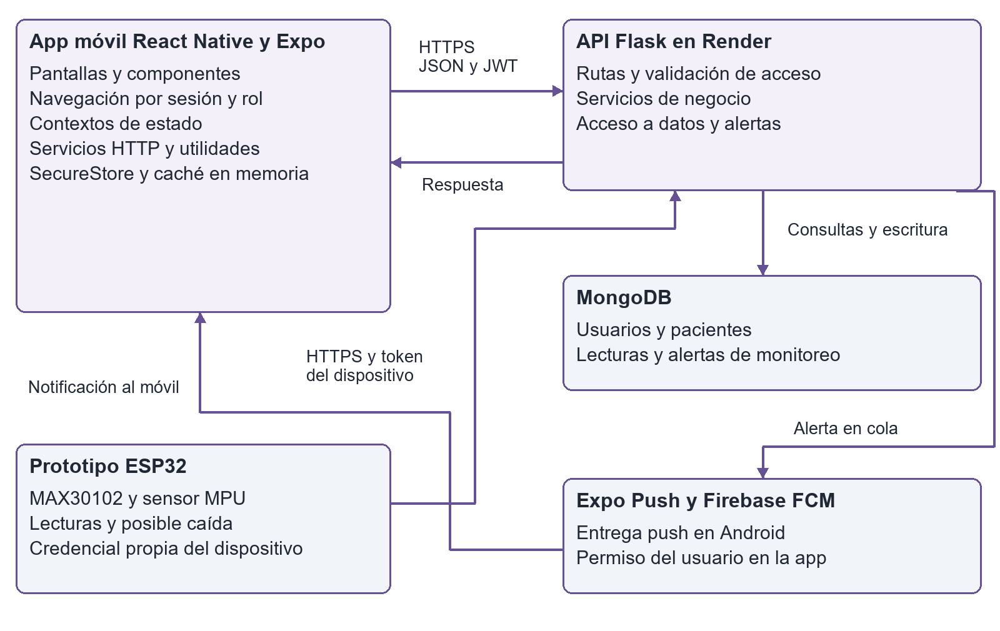
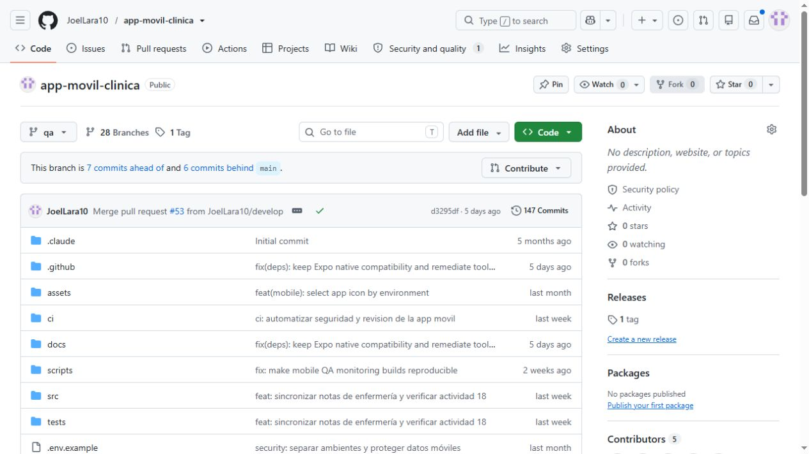
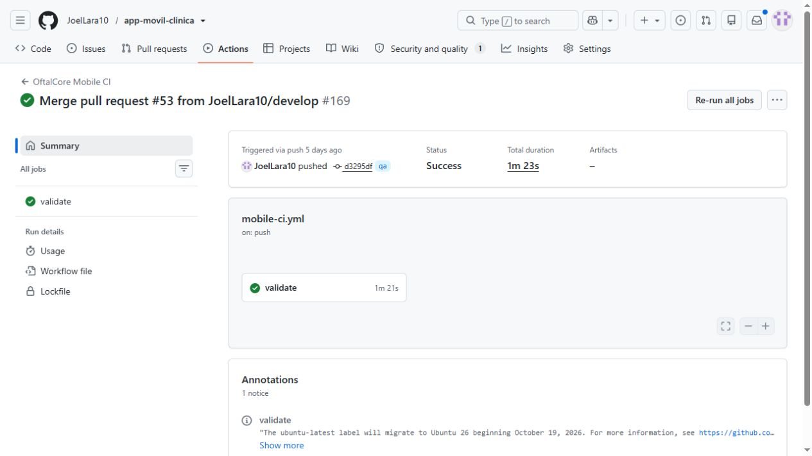
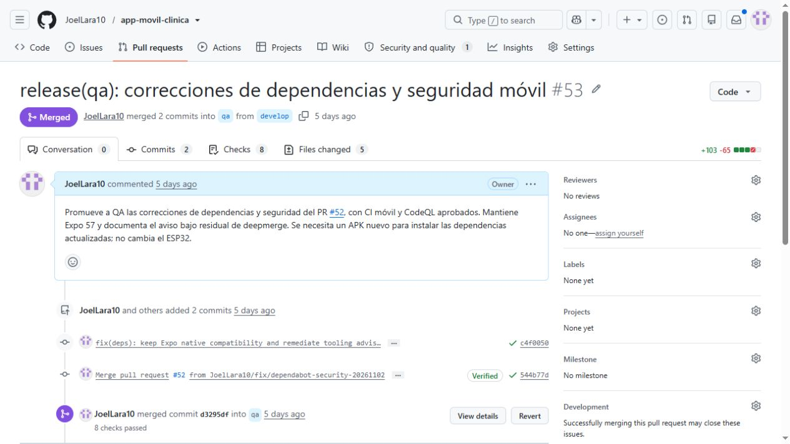
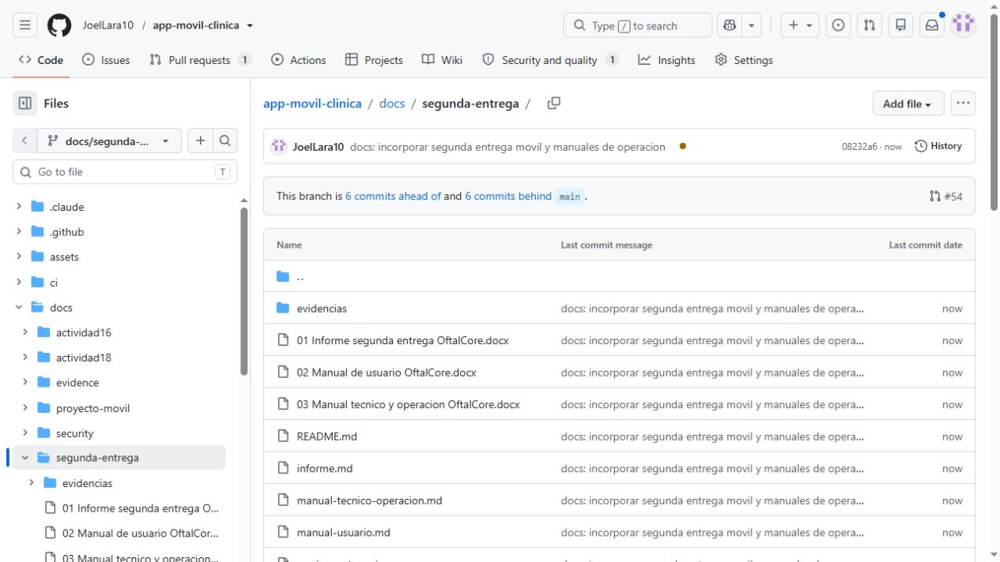
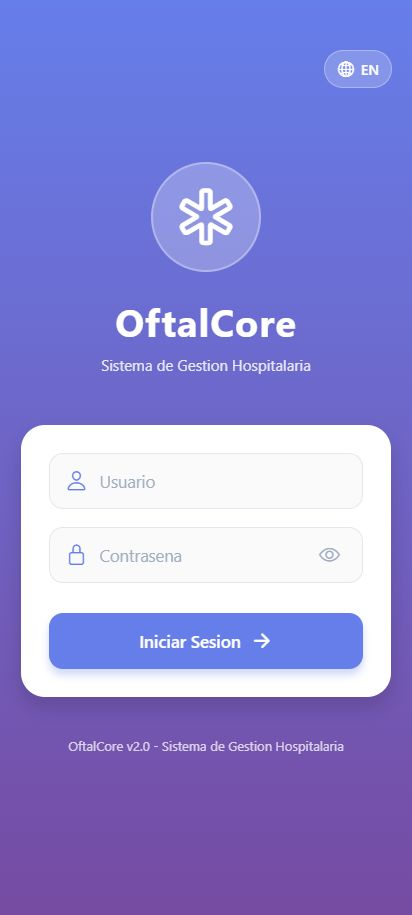
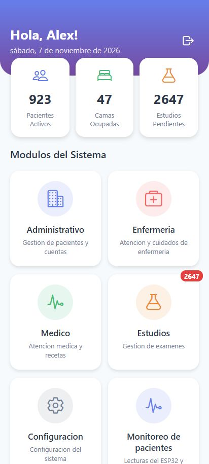

# Segunda entrega de OftalCore móvil

OftalCore móvil · Segunda entrega · 28 de noviembre de 2026
Preparado el 7 de noviembre y actualizado el 8 de noviembre de 2026.

Lara Rodriguez Joel Alejandro  ·  IDGS 101  ·  Décimo cuatrimestre
Desarrollo móvil integral  ·  ITIC Roberto Vinicio Camacho Mendoza
Entrega del 28 de noviembre de 2026  ·  Corte de evidencia del 7 de noviembre de 2026

## 1 Caso de estudio y objetivo general

La clínica oftalmológica requiere que su personal consulte y registre información desde el teléfono con acceso según sus funciones. OftalCore móvil integra autenticación remota, expedientes, módulos clínicos y administrativos, resultados de estudios y monitoreo de pacientes. La app utiliza una API compartida con el cliente web y servicios externos para compilación y notificaciones.

El objetivo es entregar una aplicación móvil trazable y reproducible, integrada con la API, acompañada de manuales, requisitos y evidencia de integración continua. La documentación distingue la implementación, las verificaciones realizadas y la validación adicional prevista para el cierre del 28 de noviembre.

### Contenido del paquete

| Entrega requerida | Evidencia y ubicación |
| --- | --- |
| Apartado A | Este informe contiene objetivos, alcance, requisitos, metodología, herramientas y marco normativo. |
| Aplicación y repositorio | Código fuente móvil en GitHub, APK Android e inventario de compilación con commit y ambiente. |
| B1 Manuales | Manual de usuario y manual técnico con instalación, operación, mantenimiento e incidencias. |
| B2 Versión integrada | APK de producción, registro EAS, pruebas de API y validación de interfaz. El alcance de pruebas en Android se identifica expresamente. |
| B3 Versionamiento de documentación | Documentos y fuentes Markdown en docs/segunda-entrega, historial de commits, pull request y capturas reales de GitHub. |

El estudiante responsable de la integración documental es Joel Alejandro Lara Rodriguez. La evaluación de la asignatura corresponde al docente. Los responsables funcionales de producto, desarrollo y QA se distribuyen durante la revisión del equipo, sin atribuir aprobaciones que no se hayan registrado.

## 2 Objetivos metas y alcance

### Objetivos específicos

1. Proteger la sesión mediante validación remota, transporte HTTPS y permisos aplicados por la API.

2. Permitir consultas y registros ligados al expediente y atención seleccionados, con validaciones y mensajes comprensibles.

3. Integrar monitoreo paginado y reconocimiento de alertas, conservando coherencia de sesión, idioma y actualización.

4. Mantener dependencias reproducibles y controles automáticos de pruebas, compilación y seguridad.

5. Entregar APK, manuales y registros de cambios vinculados a la misma base de código.

| Meta de la entrega | Medida y estado al corte |
| --- | --- |
| Pruebas del cliente | 55 casos móviles aprobados en la ejecución del 7 de noviembre. |
| Seguridad de dependencias | Auditoría actual con 0 vulnerabilidades reportadas en todos los niveles tras actualizar los parches compatibles de Expo SDK 57. |
| Autenticación remota | Producción respondió 200 al acceso y 401 sin JWT o después de revocarlo. |
| Trazabilidad | Conservar identificador EAS, commit, ambiente, documentación y checksum del APK. |
| Cierre funcional | Repetir en Android instalado los recorridos críticos y registrar modelo, versión y responsable antes de la aceptación final. |

### Alcance funcional y límites

La entrega comprende el cliente Android, su consumo de la API de OftalCore, la documentación y el proceso de integración. El prototipo ESP32 aporta telemetría al ambiente al que esté asociado. La demostración del dispositivo y sus alertas se conserva en QA. Producción cuenta con su propio conjunto de datos y la búsqueda del expediente sintético de QA devolvió cero coincidencias.

Las lecturas del prototipo y una posible caída son información de apoyo del proyecto académico. La validación clínica, certificación de dispositivos, publicación en tiendas y aprobación institucional del tratamiento de datos requieren procesos adicionales. La instalación interna del APK se documenta separadamente de esos procesos.

## 3 Requerimientos funcionales

| ID | Requerimiento | Criterio de aceptación |
| --- | --- | --- |
| RF01 | Autenticación remota | Usuario y contraseña se envían por HTTPS. Una sesión válida abre el dashboard y una respuesta de rechazo conserva el login. |
| RF02 | Sesión y cierre | La app revalida la sesión al abrir. El cierre solicita revocación y limpia la sesión local. |
| RF03 | Acceso según función | El menú ofrece los módulos del rol. La API rechaza operaciones no autorizadas. |
| RF04 | Pacientes y atención | La consulta permite seleccionar el contexto requerido por cada formulario y conservar su identificador. |
| RF05 | Registro clínico | Formularios de signos, notas, diagnósticos y recetas validan campos y envían el contexto clínico a la API. |
| RF06 | Nota de enfermería | El texto requerido admite hasta 5000 caracteres. Después de HTTP 201 se vuelve a consultar para verificar el id_nota. |
| RF07 | Resultados de estudios | Un rol autorizado consulta o adjunta resultados asociados a una solicitud. La descarga usa autenticación. |
| RF08 | Monitoreo paginado | La lista permite búsqueda y páginas de 10 registros. El detalle distingue lectura reciente, ausencia de contacto y desconexión. |
| RF09 | Reconocer una alerta | Una operación autorizada cambia su estado y la siguiente consulta refleja el reconocimiento. |
| RF10 | Notificaciones Android | Con permiso, configuración FCM y sesión válida se registra el dispositivo. Una notificación abre el paciente permitido. |
| RF11 | Español e inglés | Etiquetas y mensajes de monitoreo cambian con el idioma seleccionado. |
| RF12 | Configuración y administración | Los usuarios autorizados acceden a catálogos, perfil y opciones administrativas disponibles para su rol. |

Estos requisitos describen las capacidades del código. La matriz de verificación de la sección 10 identifica cuáles cuentan con ejecución automatizada, evidencia remota o demostración previa. La existencia de una pantalla por sí sola no acredita todos sus casos de uso.

## 4 Requerimientos no funcionales

| ID y atributo | Requerimiento verificable | Comprobación |
| --- | --- | --- |
| RNF01 Seguridad | QA y producción deben usar HTTPS. El token nativo se conserva en SecureStore y los permisos se aplican en servidor. | Configuración, pruebas de sesión y respuestas 401 o 403. |
| RNF02 Privacidad | La notificación evita nombres y signos vitales. Las evidencias usan datos sintéticos o información agregada. | Revisión del contenido push y de los anexos. |
| RNF03 Eficiencia | Monitoreo usa páginas de 10, caché temporal de 120 segundos y un máximo de 40 entradas por sesión. | Pruebas de caché y revisión de consultas. |
| RNF04 Robustez | Un error de red debe informar al usuario. Una nota con respuesta incierta requiere consultar antes de reenviar. | Casos de error y prueba de interrupción controlada. |
| RNF05 Compatibilidad | Mantener la matriz React Native y Expo bloqueada y exportar el paquete Android. | npm ci, Expo Doctor y compilación EAS. |
| RNF06 Usabilidad | Conservar navegación de regreso, idioma y estados de carga o error. Revisar etiquetas accesibles. | Recorridos de usuario y revisión de accesibilidad. |
| RNF07 Mantenibilidad | Separar pantallas, contextos, servicios y validaciones. Revisar cada cambio por PR. | Inspección de estructura, diff y resultados CI. |
| RNF08 Trazabilidad | Relacionar la versión instalable con commit, perfil, build y documentación. | Inventario de versión y hash SHA256 del archivo. |
| RNF09 Disponibilidad | Detectar indisponibilidad y conservar la última consulta identificada cuando corresponda. | /health, logs y mensajes de red. No se garantiza un SLA del prototipo. |

Se utilizará una meta de respuesta de hasta tres segundos para consultas habituales con el servicio activo y red estable. Es un objetivo de aceptación por medir, no un resultado general de carga. Los registros conservan los tiempos de cada solicitud y documentan un arranque inicial de QA cercano a 41 segundos.

## 5 Metodología y organización del trabajo

Se selecciona Scrum como marco para priorizar necesidades, inspeccionar incrementos y adaptar el trabajo a la retroalimentación [1]. El proyecto existente se apoya en ramas y revisiones de GitHub. Para esta entrega se propone un ciclo semanal hasta el 28 de noviembre, con un backlog ordenado por riesgo y valor para los usuarios.

### Justificación de la selección

Los módulos comparten autenticación y contexto de pacientes, por lo que sus cambios deben revisarse de forma incremental. Scrum permite fijar un objetivo por iteración y demostrar un recorrido concreto. El tablero visual limita trabajo abierto y el pull request concentra la discusión técnica y las pruebas. Las reuniones y asignaciones futuras se registran como planificación, sin inventar actas de ejecución.

| Periodo propuesto | Objetivo | Resultado esperado |
| --- | --- | --- |
| 7 al 13 de noviembre | Consolidar requisitos, manuales y revisión técnica. | Backlog trazado y paquete documental versionado. |
| 16 al 20 de noviembre | Validar la versión Android con usuarios de prueba. | Casos de uso ejecutados, incidencias y correcciones revisadas. |
| 23 al 27 de noviembre | Cerrar regresiones y preparar la aceptación. | Versión candidata congelada y matriz de resultados. |
| 28 de noviembre | Demostrar y entregar. | APK, enlaces, manuales y evidencia de versión. |

### Responsabilidades y coordinación

Producto ordena necesidades y criterios. Desarrollo mantiene app y contratos con la API. QA verifica escenarios y evidencia. Integración revisa CI, ambientes y binarios. Joel consolida el expediente documental. La aceptación de la entrega corresponde al responsable designado por el equipo y al docente en el contexto académico.

Cada tarea registra requisito, responsable, rama, resultado esperado y evidencia. El seguimiento diario revisa avance e impedimentos. La revisión semanal muestra el incremento y la retrospectiva registra una mejora concreta para el siguiente ciclo. Una tarea queda terminada al cumplir su aceptación y pasar los controles aplicables.

## 6 Herramientas de colaboración y monitoreo

| Proceso | Herramienta y justificación | Uso en la entrega |
| --- | --- | --- |
| Comunicación técnica | Conversaciones de pull requests en GitHub conservan contexto, decisiones y archivos del cambio. | PR de dependencias 52 y promoción 53. Se propone Issues para registrar defectos con responsables. |
| Desarrollo | JavaScript, React Native 0.86.3, React 19.2.3 y Expo 57.0.32 reutilizan componentes y módulos nativos. | Pantallas, contextos y servicios del cliente. |
| Control de versiones | Git y GitHub permiten revisar diferencias y relacionar cambios con la documentación. | Ramas de trabajo, develop, qa y main. |
| Integración continua | GitHub Actions ejecuta instalación reproducible, pruebas, Expo Doctor y exportaciones. | CI de QA aprobado sobre d3295df (E02); actualización de esta entrega aprobada en PR 54. |
| Revisión de seguridad | npm audit, oxlint, detector de secretos y CodeQL separan los controles y conservan informes. | 55 pruebas actuales y auditoría del 7 de noviembre. |
| Compilación | Expo EAS conserva firma, perfil, logs y artefacto por build. | APK QA y compilación production-apk 8. |
| Monitoreo técnico | Render y /health permiten revisar disponibilidad y errores de API. EAS y Actions muestran fallos de build o CI. | Comprobaciones HTTP y enlaces de operación. No se declara configurado un APM adicional. |

### Administración eficiente de recursos

Las dependencias se instalan con npm ci a partir del lockfile. La paginación y la caché temporal reducen consultas repetidas. El monitoreo actualiza cada diez segundos únicamente mientras la vista está activa. Los cambios se agrupan en tareas revisables y se aprovecha el tiempo de compilación remota para documentación y pruebas independientes.

## 7 Arquitectura patrones e integración

OftalCore utiliza una arquitectura cliente servidor. La app organiza presentación, estado y acceso remoto en capas lógicas. La API Flask concentra autorización y reglas de negocio, y MongoDB persiste información. Esta separación permite reutilizar contratos entre móvil y web y probar validaciones de forma independiente.

Figura 1. Diseño del sistema. El flujo IoT opera en el ambiente configurado en el firmware. La integración push depende de la configuración del servicio y de la autorización del usuario.

Los proveedores de contexto comparten sesión, paciente e idioma. Los servicios por dominio reutilizan el cliente Axios y sus interceptores. Las pantallas se construyen por composición. La caché de consultas usa claves de sesión y generación para descartar respuestas de una sesión anterior. Los listeners de notificación validan el destinatario antes de navegar.

## 8 Seguridad APIs de terceros y nube

### Mecanismos de seguridad implementados

La sesión se obtiene mediante la API propia y se revalida con /auth/me. El token nativo se guarda en SecureStore. El cierre solicita revocación y limpieza local. Las descargas envían autenticación en cabeceras y los endpoints aplican permisos. Los mensajes de error omiten detalles internos. La caché clínica se mantiene en memoria y las notificaciones evitan información clínica en la pantalla bloqueada.

En la exportación web el almacenamiento de sesión sigue la implementación web del proyecto. La protección nativa de SecureStore se verifica mediante código y pruebas específicas, no mediante capturas del navegador. Los parches compatibles de Expo SDK 57 retiraron los avisos previos de dependencias. La auditoría actual no reporta vulnerabilidades; se mantiene su revisión continua.

| Integración | Responsabilidad | Intercambio y protección |
| --- | --- | --- |
| API propia de OftalCore | Autenticación, pacientes, registros y monitoreo. | HTTPS, JSON y token de sesión. Es un backend del proyecto. |
| Expo Push Service | API de tercero usada por el backend para envío y comprobación de notificaciones [3]. | La app obtiene un ExpoPushToken. El servidor envía aviso y referencia de evento. |
| Firebase Cloud Messaging | Proveedor de transporte Android integrado a través de Expo [4]. | El archivo público de app y la credencial privada del servicio tienen funciones distintas. La clave privada permanece fuera de Git. |
| Expo EAS | Servicio de nube para compilar el APK y administrarlo por build. | Credenciales remotas existentes y artefacto firmado. |
| Render y MongoDB | API desplegada y persistencia remota. | Configuración de conexión y secretos en el ambiente del servicio. |
| GitHub y Actions | Almacenamiento del código, revisiones y ejecución CI. | Acceso por cuenta, permisos mínimos del workflow e informes trazables. |

La aplicación usa Firebase para mensajería. La identidad del usuario la valida la API de OftalCore. Esta distinción permite justificar la API de terceros sin atribuir a Firebase la autenticación que realiza el backend propio.

## 9 Marco normativo y regulatorio

El caso se plantea para una clínica privada en México. La aplicabilidad concreta depende del tratamiento real y del responsable del servicio. Las siguientes obligaciones se consideran al diseñar y liberar el sistema. Las evidencias académicas emplean información sintética. La enumeración no constituye una certificación de cumplimiento.

| Disposición y naturaleza | Aplicación al proyecto | Acción y evidencia requerida |
| --- | --- | --- |
| LFPDPPP / Ley mexicana [5] | Si la clínica privada trata datos identificables de pacientes, requiere medidas para el tratamiento de información sensible. | Definir responsable y finalidades, aviso de privacidad, base de tratamiento y atención de derechos. El proyecto aporta acceso restringido y protección de sesión. La gestión legal corresponde a la institución. |
| NOM 004 SSA3 2012 / Expediente clínico [6] | Aplica al expediente clínico de los prestadores de salud en su ámbito. | Revisar integración, manejo, confidencialidad y conservación. Validar con responsables clínicos los formatos, autoría y política institucional. |
| NOM 024 SSA3 2012 / SIRES e intercambio [7] | Se debe evaluar si el sistema se utiliza como registro electrónico para salud e intercambio dentro del ámbito de la norma. | Analizar catálogos, interoperabilidad, seguridad y evaluación de conformidad. El uso de JSON y REST no acredita por sí mismo conformidad. |
| Ley Federal del Derecho de Autor [8] | Protege software y recursos de terceros utilizados en el proyecto. | Conservar avisos de licencias, atribuciones y autorización de imágenes o código reutilizado. Revisar dependencias antes de distribuir. |

La ley de datos de particulares consultada se publicó el 20 de marzo de 2025 y muestra reforma del 14 de noviembre de 2025. El texto de derecho de autor consultado muestra reforma del 14 de mayo de 2026. Las versiones oficiales se enlazan en las fuentes y deberán revisarse de nuevo antes de la operación real.

Si el responsable fuera una institución pública, se debe revisar el régimen de sujetos obligados y el marco local correspondiente. La entrega no supone que las normas de instituciones públicas y privadas sean intercambiables. La evaluación regulatoria del prototipo como dispositivo médico depende de su uso previsto y requiere una revisión específica antes de uso clínico.

## 10 Estándares de calidad y esquema de pruebas

| Referencia técnica | Uso en el desarrollo | Estado de aplicación |
| --- | --- | --- |
| Scrum Guide 2020 [1] | Planificar, inspeccionar y adaptar incrementos. | Metodología seleccionada y calendario propuesto. Los eventos deben registrar sus resultados. |
| OWASP MASVS [2] | Revisar almacenamiento, autenticación, red, código y privacidad. | Controles de sesión, HTTPS y pruebas de permisos. Sin declaración de certificación. |
| ISO IEC 25010 2023 [9] | Definir y evaluar atributos de calidad del producto. | Requisitos no funcionales y criterios medibles. Se usa como referencia de calidad. |
| WCAG 2.2 [10] | Orientar contraste, etiquetas, mensajes y navegación accesible. | Referencia para vistas y exportación web. La accesibilidad nativa requiere revisión en Android con sus ayudas técnicas. |

### Matriz de verificación de la versión

| Nivel | Resultado acreditado al 7 de noviembre |
| --- | --- |
| Pruebas móviles | 55 aprobadas. Archivo evidencias/pruebas-movil.txt. |
| Dependencias | 0 vulnerabilidades reportadas en todos los niveles; 55 pruebas del cliente aprobadas. |
| API QA | Disponibilidad, login, /auth/me, detalle del paciente sintético y revocación verificados. El arranque frío queda registrado. |
| API producción | Login, sesión, catálogo y consulta filtrada respondieron 200. Sin JWT y tras logout respondieron 401. |
| Interfaz contra producción | La exportación web del cliente abrió login, dashboard y monitoreo filtrado. Las capturas identifican esa modalidad. |
| Android | Build firmado y pruebas previas de QA se conservan. La instalación y UAT de la compilación 8 deben registrar resultado en el teléfono del equipo. |

Los registros HTTP conservan estado, ruta y tiempo sin contraseñas, JWT ni nombres de pacientes. La evidencia de 403 en roles procede de pruebas aisladas del proyecto y se diferencia de las consultas remotas realizadas en esta entrega.

## 11 Liberación continua y versión integrada

El flujo de entrega es rama de trabajo, develop, qa y main. La integración continua valida el código automáticamente. La liberación del APK es controlada mediante un perfil EAS y aceptación de los resultados. Los binarios de QA y producción se diferencian por ambiente, nombre, icono y URL.

| Identificador | Versión y procedencia |
| --- | --- |
| Base de código móvil | d118eed6370a33b28726a07b225e9d3aceba8749 |
| Versión de aplicación | 1.0.0. El texto v2.0 visible en el pie del login es una etiqueta de interfaz heredada y no el número de versión del paquete. |
| Compilación de producción | Android versionCode 8. Perfil production-apk. Estado EAS FINISHED. |
| Build EAS | 8fdabf17-684a-4b27-a3e9-ad0fdd9aa227 |
| API de producción | https://api-clinica-jx4m.onrender.com/api/v1 |
| API y APK QA | QA usa su API y la compilación c0623630-4ca4-44b1-8d89-d57ec7c1d2b0. |
| Documentación | docs/segunda-entrega y manuales Markdown. Commit 08232a6 y PR 54 documentan la incorporación y actualización de los manuales en GitHub. |

El instalador de producción se entrega con su checksum y un manifiesto. La compilación se generó desde la base QA identificada. Los cambios documentales posteriores conservan el código de la aplicación. El enlace EAS permite comprobar firma, perfil y artefacto sin confundirlo con un despliegue de la API.

### Criterios de aceptación y recuperación

Se revisan CI, inicio y cierre de sesión, consulta autorizada, contexto de pacientes, errores de red y permisos de notificación. Antes de aceptación de uso se instala el APK, se registra modelo y Android y se ejecutan los recorridos del manual. Ante una regresión se conserva el APK anterior y se revierte el cambio mediante PR tras comprobar compatibilidad con la API. No se restaura una base de datos de producción como parte de una prueba de app.

## 12 Evidencia del repositorio y de CI

E01. Repositorio público y estructura de código en la rama QA. Captura real del 7 de noviembre.

E02. GitHub Actions muestra Success para la versión QA d3295df. El workflow valida pruebas, diagnóstico y exportaciones.

Repositorio móvil  https://github.com/JoelLara10/app-movil-clinica
Ejecución CI  https://github.com/JoelLara10/app-movil-clinica/actions/runs/41531514710

## 13 Evidencia de promoción y documentación

E03. PR 53 fusionado de develop hacia QA, con las correcciones de dependencias y seguridad.

E07. Manuales y actualización documental almacenados en GitHub. La captura corresponde a la rama y commit que se identifican en el registro de entrega.

Enlace a documentación  https://github.com/JoelLara10/app-movil-clinica/tree/docs/segunda-entrega-movil-20261128/docs/segunda-entrega

## 14 Evidencia de funcionamiento en producción

Se ejecutó la exportación web del cliente móvil del proyecto conectada a la API de producción. El inicio de sesión con la cuenta de prueba autorizada abrió el dashboard. Las imágenes muestran el cliente a tamaño de teléfono y no se presentan como capturas de un APK instalado.

E04 y E05. Login y dashboard contra producción. Las cifras del dashboard son agregadas. La contraseña y el token no aparecen en las capturas.

El registro verificacion-produccion.json conserva las siete comprobaciones HTTP. Login, sesión, catálogo y búsqueda filtrada respondieron 200. El recurso sin token y el token revocado recibieron 401. La búsqueda del identificador sintético de QA devolvió cero coincidencias.

## 15 Manuales y relación de entregables

| Archivo o elemento | Uso para evaluación |
| --- | --- |
| Informe de segunda entrega | Objetivos, requisitos, metodología, herramientas, marco normativo, integración y evidencias A y B. |
| Manual de usuario | Instalación, acceso, módulos, monitoreo, notificaciones, idioma y resolución de problemas. |
| Manual técnico y de operación | Estructura, entorno, contratos, compilación, despliegue controlado, monitoreo, mantenimiento y recuperación. |
| APK de producción | Instalador firmado de Android versión 1.0.0 compilación 8 y enlace de respaldo a EAS. |
| Código fuente | Repositorio en funcionamiento y copia ZIP del commit de entrega, con manifiesto de procedencia. |
| Registros y documentación | Fuentes Markdown, capturas, resultados de pruebas, auditoría y comprobaciones remotas sin credenciales. |

### Demostración sugerida para el docente

1. Abrir el repositorio y ubicar los manuales, el historial y las ejecuciones CI.

2. Instalar el APK del ambiente elegido e iniciar sesión con la cuenta de prueba autorizada.

3. Mostrar el dashboard y un recorrido permitido por el rol. Usar exclusivamente expedientes sintéticos para las evidencias.

4. En QA, abrir el expediente asociado al prototipo, revisar lecturas y alertas y demostrar su reconocimiento.

5. Cerrar sesión y comprobar el rechazo de un recurso protegido. Relacionar el resultado con el registro HTTP.

La aceptación nativa de la compilación 8 debe añadirse después de la ejecución en el dispositivo. La documentación ya incluye los procedimientos para registrarla. Los resultados técnicos existentes y las pruebas por realizar se mantienen identificados para que el evaluador pueda comprobar su alcance.

## 16 Fuentes consultadas y conclusión

[1] Scrum Guide 2020. https://scrumguides.org/scrum-guide.html

[2] OWASP Mobile Application Security Verification Standard. https://mas.owasp.org/MASVS/

[3] Expo Push Service y envío de notificaciones. https://docs.expo.dev/push-notifications/sending-notifications/

[4] Firebase Cloud Messaging. https://firebase.google.com/docs/cloud-messaging

[5] Cámara de Diputados Ley Federal de Protección de Datos Personales en Posesión de los Particulares. https://www.diputados.gob.mx/LeyesBiblio/pdf/LFPDPPP.pdf

[6] Secretaría de Gobernación NOM 004 SSA3 2012. https://sidof.segob.gob.mx/notas/docFuente/5272787

[7] Secretaría de Gobernación NOM 024 SSA3 2012. https://sidof.segob.gob.mx/notas/docFuente/5280847

[8] Cámara de Diputados Ley Federal del Derecho de Autor. https://www.diputados.gob.mx/LeyesBiblio/pdf/LFDA.pdf

[9] ISO IEC 25010 2023 Modelo de calidad de producto. https://www.iso.org/standard/78176.html

[10] W3C Web Content Accessibility Guidelines 2.2. https://www.w3.org/TR/WCAG22/

Consulta de referencias oficiales realizada el 7 de noviembre de 2026. Los archivos del repositorio y los registros de esta entrega sustentan los datos específicos de implementación y ejecución. Las referencias externas orientan metodología, seguridad, calidad y obligaciones del uso previsto.

### Conclusión

OftalCore móvil integra una interfaz por roles con servicios remotos, almacenamiento y mensajería de terceros. La entrega relaciona requisitos, implementación, pruebas y versión instalable mediante GitHub y EAS. Los manuales permiten reproducir el entorno y operar los recorridos principales, mientras el registro de evidencias permite revisar qué fue comprobado y qué requiere aceptación en Android o revisión institucional.
