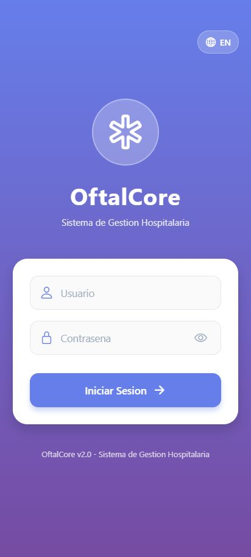
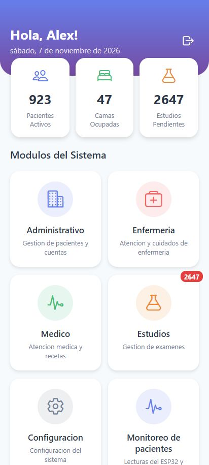
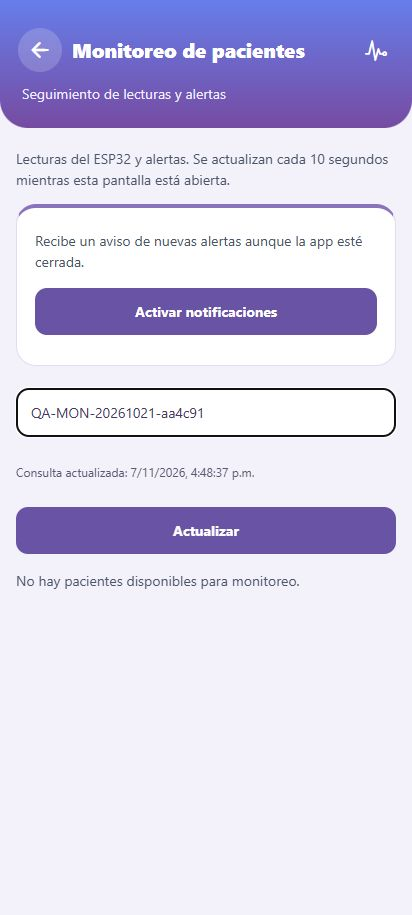

# Manual de usuario de OftalCore móvil

OftalCore móvil · Segunda entrega · 28 de noviembre de 2026
Preparado el 7 de noviembre y actualizado el 8 de noviembre de 2026.

Lara Rodriguez Joel Alejandro  ·  IDGS 101  ·  Décimo cuatrimestre
Desarrollo móvil integral  ·  ITIC Roberto Vinicio Camacho Mendoza
Entrega del 28 de noviembre de 2026  ·  Corte de evidencia del 7 de noviembre de 2026

## 1 Propósito instalación y acceso

Este manual está dirigido al personal autorizado de administración, enfermería, medicina y estudios. Describe el uso de la aplicación Android y las funciones disponibles según la cuenta. La versión técnica de referencia es 1.0.0 compilación 8 para producción. El APK de QA se utiliza para las demostraciones del prototipo ya asociado.

1. Descargar el APK desde el enlace EAS o el paquete entregado por el responsable del proyecto. Verificar su ambiente y procedencia.

2. Abrir el archivo en el teléfono. Si Android solicita permiso de instalación para el navegador o gestor de archivos, concederlo únicamente para instalar el paquete recibido y revisar las instrucciones del sistema.

3. Abrir OftalCore y mantener conexión a Internet. La instalación interna utiliza un APK firmado del proyecto.

4. Introducir el usuario y la contraseña asignados. Pulsar Iniciar sesión y esperar la respuesta.

5. Comprobar nombre y rol en el dashboard. Si las credenciales se rechazan, corregirlas o solicitar apoyo al administrador.

Las credenciales se comunican por un canal autorizado y no se incluyen en este manual. QA y producción utilizan APIs diferentes. El nombre o icono QA identifica la compilación de pruebas. Las cuentas y expedientes deben corresponder al ambiente elegido.

### Resultado esperado

Una sesión aceptada muestra el dashboard. Un error de acceso conserva la pantalla de inicio y muestra un mensaje. Ante una demora de red, esperar el resultado y evitar pulsaciones repetidas. Si se mantiene el error, registrar hora y ambiente sin compartir la contraseña.

## 2 Pantallas iniciales y navegación

Figuras 1 y 2. Pantallas reales del cliente exportado a web y conectado a producción. Se incluyen como referencia visual del manual. La prueba nativa se registra por separado.

Desde el dashboard se abre el módulo autorizado. La flecha superior permite regresar en las vistas que la incorporan. El menú lateral ofrece navegación por secciones y cierre de sesión. Las cifras del inicio son indicadores del sistema y no sustituyen el detalle del expediente.

| Perfil | Funciones que debe verificar con su cuenta |
| --- | --- |
| Administración | Pacientes, cuentas, camas y configuración autorizada. |
| Medicina | Consulta de atención, historia, signos, notas, diagnóstico, receta y documentos. |
| Enfermería | Signos, notas, medicamentos, valoración, balance y cuidados. |
| Estudios | Solicitudes, consulta y carga de resultados según permisos. |

## 3 Pacientes y registro de notas

### Seleccionar contexto de paciente

1. Entrar al módulo correspondiente y localizar el expediente autorizado.

2. Abrir su detalle y comprobar que el expediente y la atención seleccionados correspondan a la operación.

3. Abrir el formulario permitido por el rol. Completar los campos requeridos y revisar los valores antes de guardar.

4. Esperar la confirmación y volver a consultar el registro cuando sea necesario.

### Registrar una nota de enfermería

1. Abrir Enfermería y seleccionar la atención del paciente.

2. Entrar a Nota de enfermería. Revisar el historial y el estado de última consulta.

3. Escribir la nota requerida con un máximo de 5000 caracteres. Usar información correspondiente a esa atención.

4. Pulsar Guardar una sola vez. El botón se bloquea durante el envío.

5. Esperar el mensaje de sincronización. El cliente vuelve a consultar y verifica el identificador devuelto por la API.

Si se interrumpe la conexión o la respuesta es incierta, consultar el historial antes de reenviar. La aplicación conserva el borrador durante errores de envío y no reintenta automáticamente un POST. Un mensaje de acceso denegado requiere revisar el rol con el administrador.

### Historia clínica signos y receta

El módulo Médico agrupa los formularios de atención. Verificar contexto, campos obligatorios y unidades que muestre la pantalla. Las validaciones del cliente se complementan con las del servidor. Ante un error de autorización, no intentar modificar identificadores ni cambiar el expediente para eludir el control.

## 4 Estudios administración y configuración

### Resultados de laboratorio y gabinete

1. Abrir Estudios y ubicar la solicitud autorizada.

2. Revisar tipo de estudio y datos de la solicitud antes de consultar, cargar o editar.

3. Para cargar un resultado, elegir el archivo permitido por el formulario. El selector admite PDF, PNG o JPEG.

4. Agregar observaciones cuando corresponda y confirmar el envío. Esperar el resultado antes de salir.

5. Consultar nuevamente la solicitud para comprobar que el archivo se relacionó correctamente.

Un archivo o solicitud que no pueda abrirse debe reportarse con su contexto al responsable. Las descargas requieren una sesión válida. Se debe evitar almacenar documentos clínicos en ubicaciones compartidas o adjuntarlos a evidencias académicas.

### Administración y configuración

Administración reúne las funciones de pacientes y cuentas disponibles para el perfil. Configuración presenta acceso a camas, personal, diagnósticos, servicios, respaldo, automatización y perfil. Cada acción depende de los permisos de la API y del rol de la cuenta. La flecha superior regresa al nivel anterior o al inicio según la pantalla.

Las acciones de usuarios, servicios o respaldos deben ser realizadas por el responsable autorizado. Para una demostración académica se utilizan registros sintéticos. Una copia de seguridad y su restauración requieren el procedimiento y la autorización de operación descritos en el manual técnico.

## 5 Monitoreo de pacientes y alertas

1. Abrir Monitoreo de pacientes desde el dashboard o el menú.

2. Usar la búsqueda por nombre o expediente. Cambiar de página con Anterior y Siguiente. La consulta muestra hasta diez registros por página.

3. Abrir Ver lecturas y alertas en el paciente autorizado.

4. Revisar hora de lectura, dispositivo, pulso, SpO₂ y movimiento. El estado indica si hay lectura reciente, desconexión o ausencia de contacto.

5. Consultar páginas de historial y alertas. Para confirmar una revisión, pulsar Reconocer alerta y esperar la actualización.

La vista se actualiza cada diez segundos mientras permanece activa. Puede mostrar información temporal de caché al volver a entrar. Usar Actualizar para solicitar una consulta. La temperatura mostrada corresponde al sensor y no a la temperatura corporal.

## 6 Demostración con datos del prototipo

### Demostración con el ESP32

El prototipo preparado está asociado al expediente sintético OFTALCORE 000205 en QA. El identificador y la credencial del dispositivo deben coincidir con su ambiente. Para demostrar lecturas se mantiene el sensor de pulso en contacto estable. Una alerta generada mediante el comando de prueba debe identificarse como simulada. La detección física de caída con MPU se prueba por un protocolo propio.

La búsqueda del expediente sintético de QA en producción devolvió cero coincidencias durante esta revisión. Esto no implica un fallo de autenticación. Se debe verificar la asociación de dispositivos y pacientes del ambiente antes de una demostración de telemetría.

Figura 3. Vista filtrada en producción sin coincidencias para el identificador sintético de QA. Captura del cliente web del proyecto.

## 7 Notificaciones idioma y cierre de sesión

### Activar notificaciones Android

1. Instalar el APK en un teléfono Android y entrar con una cuenta clínica autorizada.

2. Abrir Monitoreo y pulsar Activar notificaciones.

3. Conceder el permiso que muestra Android. Verificar el mensaje de activación.

4. Mantener Internet y probar un evento del ambiente correcto. Revisar que el servicio del backend tenga habilitado el envío.

5. Tocar la notificación para abrir el paciente permitido. Si la sesión ya no es válida, iniciar sesión antes de consultar.

La recepción requiere el token de notificación registrado, credencial FCM, permiso del teléfono y envío activo en servidor. Cerrar normalmente la aplicación permite probar la recepción en segundo plano. La opción Forzar detención de Android puede impedirla hasta volver a abrir la app. La prueba web no acredita el transporte push nativo.

### Cambiar idioma

Usar el control ES o EN disponible en la interfaz para cambiar español e inglés. Comprobar las etiquetas de monitoreo, estados y mensajes. Si un texto no cambia, reportar la pantalla y el idioma elegido.

### Cerrar sesión

Pulsar Cerrar sesión en el menú o el control disponible y confirmar en Android. El cliente solicita revocación al servidor y limpia la información local. Al terminar, comprobar el regreso al inicio. En un teléfono compartido, cerrar la sesión después de utilizarlo y evitar compartir la cuenta.

## 8 Resolución de problemas y aceptación

| Situación | Comprobación y respuesta |
| --- | --- |
| No inicia sesión | Verificar ambiente, usuario, contraseña e Internet. Si persiste, anotar hora y mensaje y consultar al administrador. |
| Carga lenta | Esperar el arranque del servicio y revisar red. En monitoreo usar Actualizar. Registrar si la consulta muestra datos de caché. |
| Sin lectura de pulso | Comprobar alimentación del ESP32, WiFi, contacto del dedo y última lectura. Una conexión a WiFi no acredita recepción en API. |
| Dispositivo desconectado | Comprobar alimentación, URL y credencial del ambiente. Consultar el monitor serie con el responsable técnico. |
| No llega notificación | Revisar permiso Android, sesión, registro push, Internet y envío habilitado en API. Abrir la app si fue forzada a detenerse. |
| Nota con estado incierto | Consultar historial antes de reenviar para evitar duplicados. |
| Acceso denegado | Verificar rol y sesión. No alterar identificadores para intentar acceder. |

### Registro de aceptación en teléfono

Registrar fecha, modelo, Android, ambiente, versión y responsable. Ejecutar instalación, login válido e inválido, navegación, consulta autorizada, guardado sintético permitido, idioma, notificación del ambiente y cierre de sesión. Para cada caso anotar resultado y evidencia. La compilación 8 necesita este registro específico antes de declarar completada su aceptación nativa.

Para solicitar soporte compartir versión, ambiente, pasos y mensaje visible. Retirar datos de pacientes y credenciales de capturas o archivos. El repositorio y el registro EAS que acompañan la entrega permiten al equipo localizar la versión afectada.
