# Manual completo de usuario de OftalCore móvil

OftalCore móvil · Segunda entrega · 28 de noviembre de 2026
Manual ampliado y revisado el 16 de noviembre de 2026.

Lara Rodriguez Joel Alejandro  ·  IDGS 101  ·  Décimo cuatrimestre
Desarrollo móvil integral  ·  ITIC Roberto Vinicio Camacho Mendoza
Entrega del 28 de noviembre de 2026  ·  Ampliación documental del 16 de noviembre de 2026

## Cómo utilizar este manual

Este manual explica las funciones disponibles en toda la aplicación móvil: acceso, administración, medicina, enfermería, estudios, configuración y monitoreo. Está organizado por tareas e indica la ruta, datos, procedimiento, resultado esperado y precauciones de cada proceso. Los permisos dependen de la cuenta y del servidor.

Para presentar el prototipo ESP32 se utiliza OftalCore QA. Producción tiene sus propios datos y API. Ambos instaladores de referencia son versión 1.0.0 build 8 y comparten el paquete Android, por lo que uno reemplaza al otro al instalarlo. El expediente 207 y la atención 926 de las capturas son sintéticos; no representan atención a una persona real.

| Perfil | Funciones en la navegación revisada |
| --- | --- |
| Admin | Administración, medicina, enfermería, estudios, configuración y monitoreo. |
| Administrativo | Funciones administrativas registradas para su rol; la API conserva la decisión final. |
| Médico | Medicina, estudios y monitoreo permitidos. |
| Enfermería | Atención de enfermería y monitoreo permitidos. |
| Estudios | Gestión de solicitudes y resultados permitidos. |

Las imágenes se capturaron el 12 y 16 de noviembre de 2026 del cliente Expo web en viewport móvil y conectado a QA. Para acceder al menú lateral en web se agregaron controles documentales de navegación únicamente en la copia local. Las imágenes recortan esa barra auxiliar, conservan los formularios originales y no acreditan pruebas nativas de Android. El código de la aplicación se restauró sin cambios después de exportar.

## Contenido

El índice se genera con los títulos de los capítulos.

## 1 Inicio de sesión

Ruta  Abrir OftalCore o OftalCore QA

Datos y controles. Usuario y contraseña de una cuenta habilitada.

1. Comprobar el ambiente del instalador y disponer de Internet.

2. Escribir usuario y contraseña. El icono del ojo permite revisar temporalmente la contraseña.

3. Pulsar Iniciar Sesion una vez y esperar la respuesta.

4. Comprobar el nombre de usuario y los módulos del dashboard.

Resultado esperado. La cuenta autorizada accede al inicio. Las credenciales rechazadas conservan el formulario.

Ante Error de conexion, verificar Internet y disponibilidad de la API; después reintentar. No compartir ni incluir la contraseña en evidencias.

Figura U1. Inicio de sesión. Cliente Expo web conectado a QA; datos sintéticos.

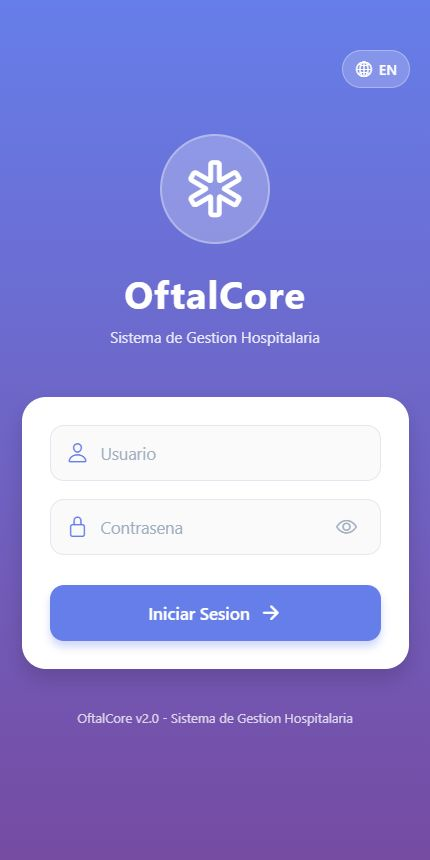

## 2 Inicio navegación e idioma

Ruta  Dashboard y menú lateral

Datos y controles. Indicadores de pacientes activos, camas ocupadas y estudios pendientes; módulos disponibles por rol.

1. Pulsar el módulo deseado en el dashboard.

2. Usar la flecha superior para volver al nivel anterior.

3. Abrir el menú lateral cuando la pantalla lo ofrezca y elegir una función del módulo actual.

4. Usar ES o EN para cambiar el idioma de la interfaz.

5. Actualizar los indicadores mediante el gesto de refrescar cuando esté disponible.

Resultado esperado. La pantalla muestra las opciones del contexto y la cuenta.

Los indicadores son agregados. Para una operación clínica se debe seleccionar primero un expediente y su atención. Algunas etiquetas heredadas aún pueden aparecer sin traducir.

Figura U2. Inicio navegación e idioma. Cliente Expo web conectado a QA; datos sintéticos.

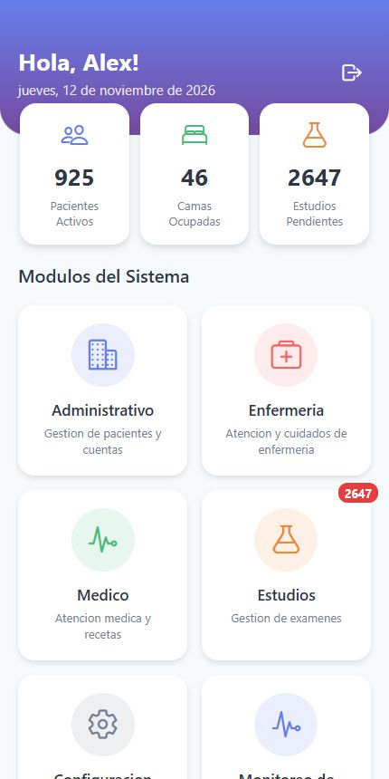

## 3 Panel administrativo

Ruta  Dashboard → Administrativo

Datos y controles. Gestión de pacientes, nuevo paciente, cuenta, censo, corte de caja y camas.

1. Entrar con un rol autorizado para administración.

2. Elegir la tarjeta del proceso que se desea realizar.

3. Verificar el nombre de la pantalla antes de capturar información.

4. Regresar al panel para cambiar de tarea.

Resultado esperado. Se abre el proceso administrativo seleccionado.

La visibilidad de una tarjeta no reemplaza el permiso del servidor. Ante acceso denegado, solicitar revisión del rol.

Figura U3. Panel administrativo. Cliente Expo web conectado a QA; datos sintéticos.

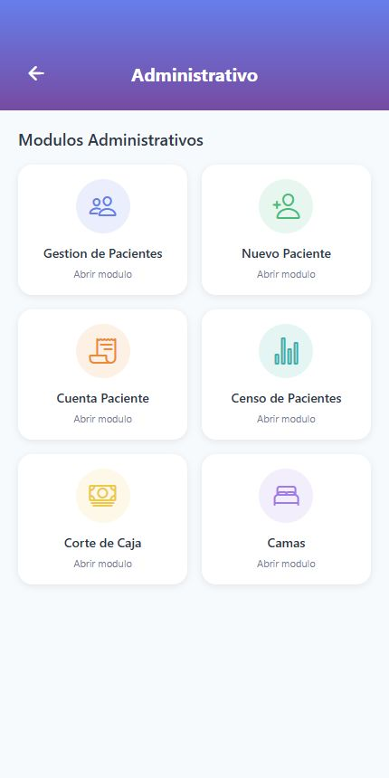

## 4 Registrar paciente o una atención nueva

Ruta  Administrativo → Nuevo Paciente

Datos y controles. CURP, apellidos, nombre, nacimiento y teléfono; área, cama, motivo, especialidad, alergias, hasta cinco médicos y familiar responsable.

1. Buscar primero el expediente previo por CURP o nombre cuando el paciente ya fue atendido.

2. Completar los datos personales requeridos y comprobar la fecha de nacimiento.

3. Seleccionar área, motivo y especialidad; elegir una cama válida cuando corresponda.

4. Seleccionar los médicos y registrar alergias y datos del familiar según la información disponible.

5. Pulsar Guardar, esperar la confirmación y localizar el expediente creado.

Resultado esperado. El expediente queda consultable y la atención se relaciona con él.

Los campos obligatorios que valida el servicio incluyen CURP, primer apellido, nombre y nacimiento. No crear otro expediente por una respuesta lenta sin buscar antes.

Figura U4. Registrar paciente o una atención nueva. Cliente Expo web conectado a QA; datos sintéticos.

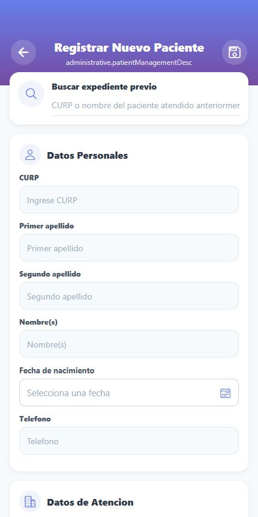

## 5 Buscar pacientes y revisar sus grupos

Ruta  Administrativo → Gestion de Pacientes

Datos y controles. Búsqueda por nombre, CURP u otro identificador admitido; grupos de activos, expedientes recientes y altas.

1. Introducir un criterio suficientemente específico en Buscar pacientes.

2. Esperar la actualización de los grupos; usar Recargar si se requiere una consulta nueva.

3. Revisar nombre, expediente y número de atención de la tarjeta.

4. Cambiar de página en el grupo cuando aparezcan los controles.

5. Elegir Editar o Cuenta en el registro correcto.

Resultado esperado. Se reduce la lista y se conserva el contexto del paciente elegido.

La lista puede usar caché temporal. Un resultado vacío no prueba que el paciente haya sido eliminado; revisar el criterio y el ambiente.

Figura U5. Buscar pacientes y revisar sus grupos. Cliente Expo web conectado a QA; datos sintéticos.

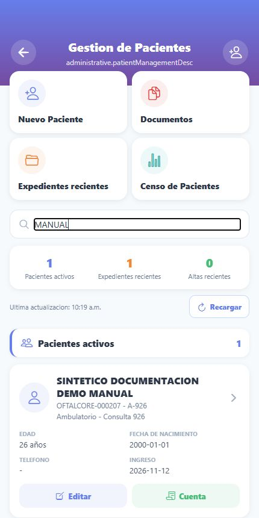

## 6 Editar datos de un expediente

Ruta  Gestion de Pacientes → Editar

Datos y controles. Identidad, contacto, atención, médicos y familiar del registro seleccionado.

1. Verificar el expediente y la atención antes de cambiar campos.

2. Esperar que termine la carga para no sobrescribir datos con valores provisionales.

3. Corregir únicamente los campos pertinentes y revisar el resultado.

4. Pulsar Actualizar una vez.

5. Volver a buscar al paciente para confirmar los datos guardados.

Resultado esperado. Los cambios se reflejan en la consulta posterior.

Cancelar o regresar evita enviar el formulario. Ante un error de red, consultar de nuevo antes de repetir la actualización.

Figura U6. Editar datos de un expediente. Cliente Expo web conectado a QA; datos sintéticos.

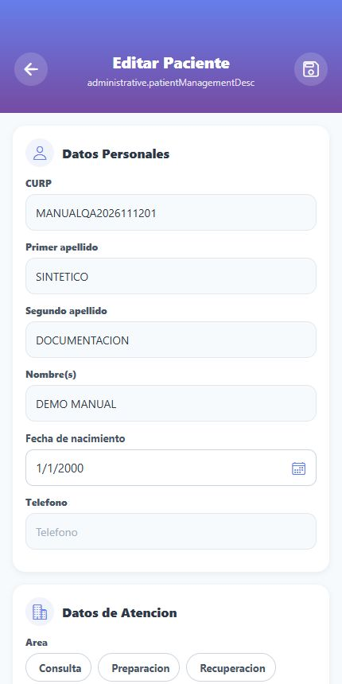

## 7 Revisar cuenta cargos y documentos

Ruta  Gestion de Pacientes → Cuenta

Datos y controles. Atención, cargos de servicios o medicamentos, cantidades, subtotal, IVA, total, saldo y documentos administrativos.

1. Verificar la cuenta y el paciente de la cabecera.

2. Revisar cargos, totales y saldo; utilizar Recargar si es necesario.

3. Para un cargo, elegir el servicio o medicamento del catálogo e indicar su cantidad; confirmar la adición.

4. Consultar los documentos disponibles, como hoja inicial, frontal, contrato, consentimiento o ficha.

5. Comprobar la descarga antes de compartir un documento por un canal autorizado.

Resultado esperado. Los conceptos se relacionan con la atención y los totales se recalculan.

No registrar cargos de prueba en producción. El cierre de cuenta afecta el estado de la atención y requiere comprobar antes la liquidación y el contexto.

Figura U7. Revisar cuenta cargos y documentos. Cliente Expo web conectado a QA; datos sintéticos.

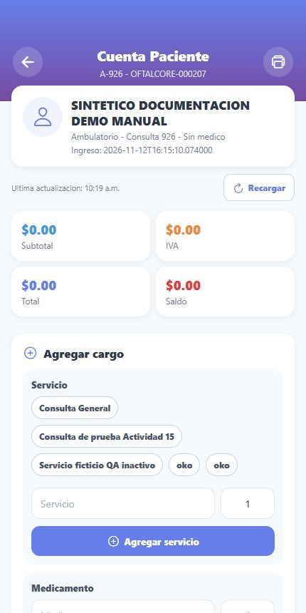

## 8 Censo y distribución de pacientes

Ruta  Administrativo → Censo de Pacientes

Datos y controles. Secciones de consulta, preparación y recuperación; búsqueda, cuenta, expediente, médico y avisos.

1. Entrar al censo y esperar que termine la consulta.

2. Filtrar la sección de interés con su campo Buscar.

3. Revisar expediente, ubicación y estado de la atención.

4. Usar Recargar para confirmar cambios recientes.

5. Regresar al módulo cuando termine la consulta.

Resultado esperado. El censo presenta la distribución del ambiente consultado.

La imagen de este manual usa un filtro sintético. No confundir un grupo filtrado vacío con ausencia de pacientes en toda la institución.

Figura U8. Consulta de censo con el mensaje de error observado. Usar Recargar y reportar la incidencia si persiste.

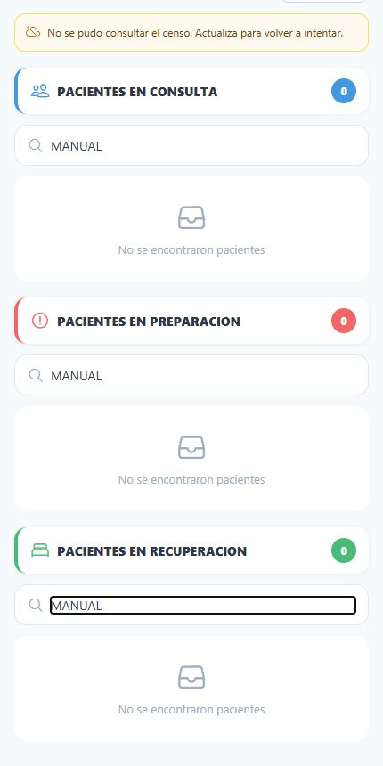

## 9 Corte de caja

Ruta  Administrativo → Corte de Caja

Datos y controles. Fecha de consulta, búsqueda, movimientos y resúmenes económicos del periodo.

1. Seleccionar la fecha que se necesita revisar.

2. Aplicar el filtro de búsqueda y esperar el resultado.

3. Revisar los movimientos y sus importes en el contexto de la cuenta.

4. Recargar cuando se hayan registrado cambios.

5. Conciliar los importes con los registros de operación antes de usar el reporte.

Resultado esperado. La consulta muestra los movimientos del periodo seleccionado.

Consultar el corte no equivale a autorizar un pago ni a cerrar una cuenta. No se ejecutaron operaciones financieras reales para estas capturas.

Figura U9. Corte de caja. Cliente Expo web conectado a QA; datos sintéticos.

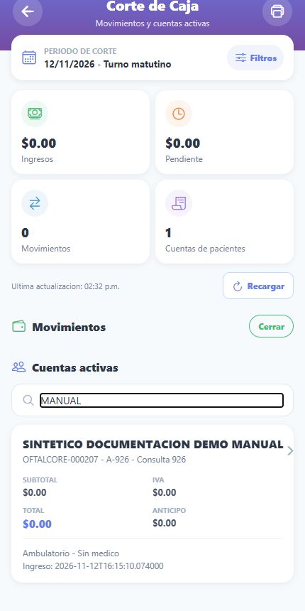

## 10 Camas y ocupación

Ruta  Administrativo → Camas o Configuracion → Camas

Datos y controles. Identificador y características de cama, área y disponibilidad según la pantalla.

1. Consultar la lista y filtrar por los controles disponibles.

2. Verificar el área y la ocupación antes de asignar o editar.

3. Para una cama nueva, abrir el formulario, completar sus datos y guardar.

4. Para corregirla, elegir Editar en el registro correcto y confirmar los cambios.

5. Actualizar la consulta para comprobar el resultado.

Resultado esperado. El catálogo y el estado muestran la información devuelta por la API.

No eliminar una cama ocupada ni modificar una asignación como parte de una demostración. La API decide si una operación es válida.

Figura U10. Camas y ocupación. Cliente Expo web conectado a QA; datos sintéticos.

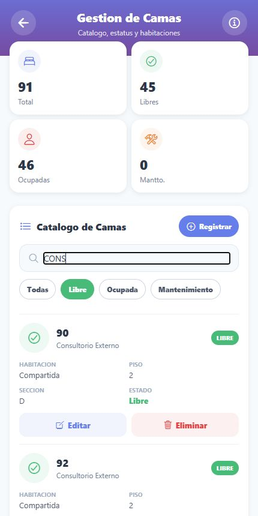

## 11 Seleccionar atención médica

Ruta  Dashboard → Medico

Datos y controles. Pacientes agrupados por área y contexto formado por Id_exp e id_atencion.

1. Localizar el expediente en el grupo de área y avanzar con las flechas de paginación cuando sea necesario.

2. Comprobar nombre, número de expediente y atención.

3. Abrir el detalle del paciente.

4. Elegir el formulario clínico que se necesita utilizar.

5. Volver a seleccionar paciente cuando se cambie de atención.

Resultado esperado. Los formularios usan el expediente y la atención seleccionados.

No reutilizar el contexto del paciente anterior. Si falta la atención activa, volver al listado o solicitar su registro administrativo.

Figura U11. Seleccionar atención médica. Cliente Expo web conectado a QA; datos sintéticos.

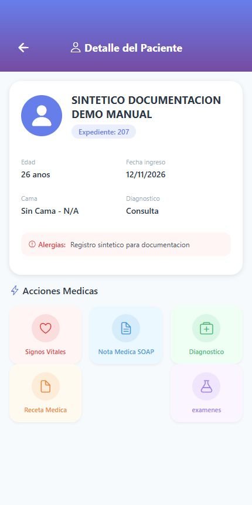

## 12 Historia clínica

Ruta  Medico → seleccionar paciente → menú lateral → Historia Clinica

Datos y controles. Motivo de consulta, síntomas, antecedentes heredofamiliares, no patológicos y patológicos; enfermedades, medicamentos, alergias, antecedentes oculares y cirugías.

1. Confirmar la atención de la cabecera y esperar la carga.

2. Escribir el motivo de consulta y seleccionar las opciones que correspondan.

3. Completar los campos Otros y antecedentes narrativos cuando proceda.

4. Revisar que el contenido corresponda al paciente actual.

5. Guardar y volver a consultar el formulario para confirmar el resultado.

Resultado esperado. La historia queda asociada con los identificadores de esa atención.

El motivo admite de 3 a 500 caracteres; los campos narrativos validados admiten hasta 2000. La app captura información, no determina diagnósticos.

Figura U12. Historia clínica. Cliente Expo web conectado a QA; datos sintéticos.

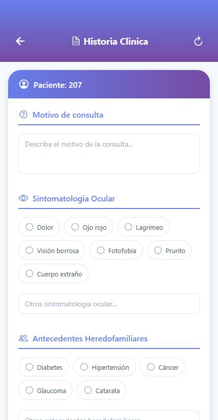

## 13 Signos vitales manuales

Ruta  Medico o Enfermeria → Paciente → Signos Vitales

Datos y controles. Presión arterial, frecuencia cardiaca y respiratoria, temperatura, SpO₂ y otros campos mostrados por el formulario.

1. Abrir Signos Vitales desde el paciente seleccionado.

2. Introducir los valores en las unidades indicadas; verificar decimales y campos requeridos.

3. Revisar las validaciones antes de enviar.

4. Pulsar Guardar una vez y esperar la respuesta.

5. Abrir el historial y comprobar fecha y valores del registro.

Resultado esperado. Los signos quedan disponibles en el historial de la atención.

Estos registros manuales son distintos de la telemetría del ESP32. No interpretar la temperatura del MPU como temperatura corporal.

Figura U13. Signos vitales manuales. Cliente Expo web conectado a QA; datos sintéticos.

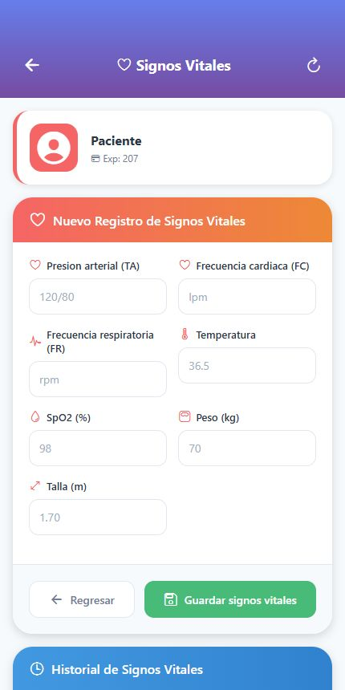

## 14 Nota médica

Ruta  Medico → Paciente → Nota Medica

Datos y controles. Subjetivo, objetivo, análisis y plan de la nota SOAP; historial de notas de la atención.

1. Comprobar al paciente de la cabecera.

2. Consultar el historial cuando se necesite revisar notas anteriores.

3. Redactar los apartados requeridos con información de la atención actual.

4. Guardar una sola vez y esperar confirmación.

5. Reabrir el historial para verificar el registro.

Resultado esperado. La nota aparece asociada a la atención y a su fecha.

No usar una demostración como registro asistencial real. Una respuesta incierta requiere consulta posterior antes de repetir el envío.

Figura U14. Nota médica. Cliente Expo web conectado a QA; datos sintéticos.

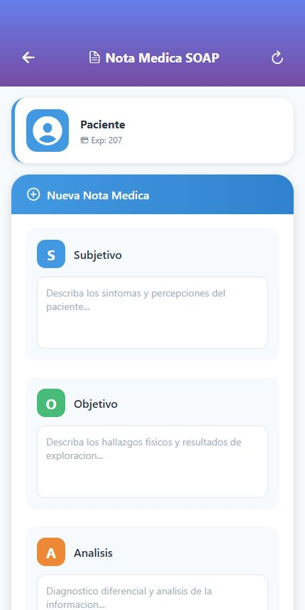

## 15 Diagnóstico

Ruta  Medico → Paciente → Diagnostico

Datos y controles. Diagnóstico principal, diagnósticos secundarios y observaciones.

1. Revisar el diagnóstico actual y el historial cuando existan.

2. Capturar o actualizar el diagnóstico principal en el campo disponible.

3. Agregar los secundarios y observaciones pertinentes.

4. Guardar y esperar el resultado.

5. Verificar el diagnóstico actual y el historial actualizado.

Resultado esperado. La información se consulta dentro de la misma atención.

El catálogo administrativo de diagnósticos se mantiene en Configuracion; este formulario corresponde al registro clínico de una atención.

Figura U15. Diagnóstico. Cliente Expo web conectado a QA; datos sintéticos.

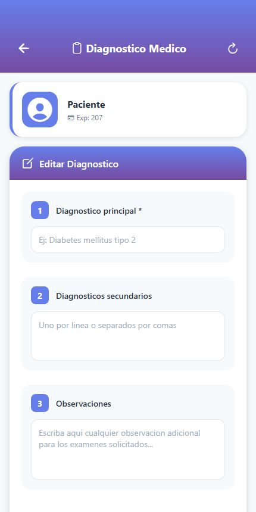

## 16 Receta y medicamentos prescritos

Ruta  Medico → Paciente → Receta

Datos y controles. Nombre del medicamento, dosis, frecuencia, duración e indicaciones por renglón.

1. Abrir la receta desde la atención correcta.

2. Capturar al menos un medicamento con nombre, dosis, frecuencia y duración.

3. Agregar o retirar renglones con los controles de la pantalla.

4. Revisar todos los renglones y las indicaciones antes de guardar.

5. Consultar el historial de recetas para comprobar el resultado.

Resultado esperado. La receta conserva los medicamentos de esa atención.

La validación permite entre 1 y 10 medicamentos. Registrar una receta no equivale a registrar su aplicación por enfermería.

Figura U16. Receta y medicamentos prescritos. Cliente Expo web conectado a QA; datos sintéticos.

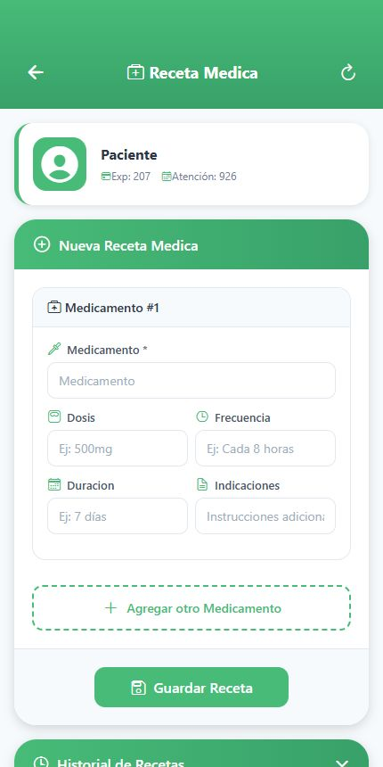

## 17 Solicitar laboratorio y gabinete

Ruta  Medico → seleccionar paciente → menú lateral → Examenes de Laboratorio o Gabinete

Datos y controles. Catálogo de estudios, selección de exámenes y datos de la solicitud.

1. Elegir Laboratorio o Gabinete según el estudio requerido.

2. Esperar la carga del catálogo y buscar las opciones necesarias.

3. Seleccionar los exámenes; revisar la lista antes de enviar.

4. Confirmar la solicitud y esperar el resultado.

5. Consultar las solicitudes del paciente o el módulo Estudios.

Resultado esperado. Los estudios solicitados se relacionan con la atención.

No enviar la misma solicitud repetidamente ante una demora. El backend puede generar conceptos de cuenta asociados al estudio.

Figura U17. Solicitar laboratorio y gabinete. Cliente Expo web conectado a QA; datos sintéticos.

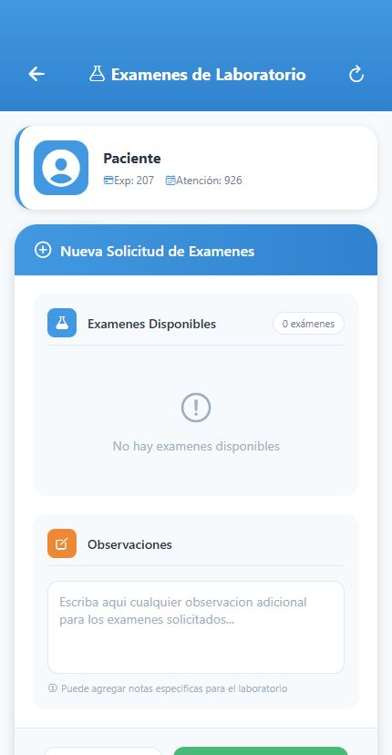

## 18 Documentos clínicos y resultados

Ruta  Medico → seleccionar paciente → menú lateral → Imprimir Documentos o Resultados de Estudios

Datos y controles. Documentos disponibles por atención y estudios de laboratorio o gabinete con su estado.

1. Elegir el tipo de documento o la categoría de resultados.

2. Verificar el expediente y la atención antes de abrir el archivo.

3. Descargar o compartir mediante las opciones que ofrezca Android.

4. Comprobar que el archivo se abre y pertenece al caso correcto.

5. Cerrar el visor y regresar a la app.

Resultado esperado. Se obtiene el documento o resultado autorizado.

Compartir un archivo requiere un destinatario y un canal autorizados. La descarga nativa necesita una sesión válida; un archivo pendiente no tiene todavía un resultado disponible.

Figura U18. Documentos clínicos y resultados. Cliente Expo web conectado a QA; datos sintéticos.

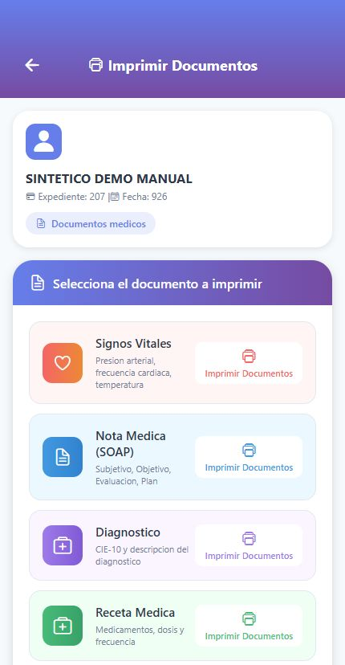

## 19 Panel de enfermería

Ruta  Dashboard → Enfermeria → Paciente

Datos y controles. Atención seleccionada y accesos a signos, nota, medicamentos, valoración, balance y cuidados.

1. Localizar al paciente en el grupo de área y cambiar de página con las flechas cuando sea necesario.

2. Verificar el expediente y el número de atención.

3. Abrir su detalle y seleccionar la actividad de enfermería.

4. Comprobar siempre la cabecera antes de capturar.

5. Volver al listado para cambiar de paciente.

Resultado esperado. Cada actividad conserva el contexto de la atención.

Una cuenta administrativa puede consultar varias áreas; el personal de enfermería utiliza las opciones permitidas por su rol y por el servidor.

Figura U19. Panel de enfermería. Cliente Expo web conectado a QA; datos sintéticos.

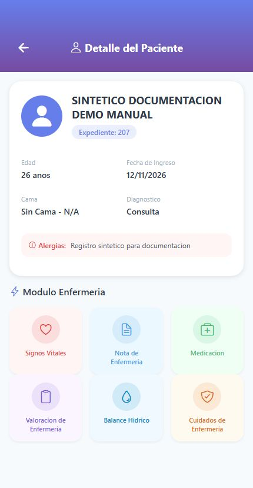

## 20 Nota de enfermería

Ruta  Enfermeria → Paciente → Nota de Enfermeria

Datos y controles. Texto de la nota e historial de notas de la atención.

1. Abrir el formulario y confirmar paciente y atención.

2. Consultar las notas anteriores cuando proceda.

3. Escribir la nota requerida, hasta 5000 caracteres.

4. Pulsar Guardar una vez; el botón queda bloqueado durante el envío.

5. Esperar la sincronización y revisar el historial actualizado.

Resultado esperado. La app consulta nuevamente y verifica el identificador de la nota guardada.

Si la conexión se interrumpe, conservar el borrador y consultar antes de reenviar. El cliente no repite automáticamente este POST.

Figura U20. Nota de enfermería. Cliente Expo web conectado a QA; datos sintéticos.

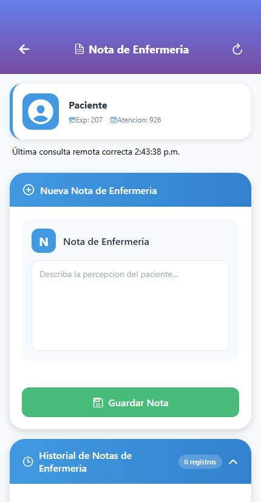

## 21 Aplicación de medicamentos

Ruta  Enfermeria → Paciente → Medicamentos

Datos y controles. Medicamento, dosis, frecuencia, vía y fecha de aplicación por renglón.

1. Consultar la indicación autorizada y confirmar al paciente.

2. Completar el medicamento y los campos de aplicación del formulario.

3. Agregar o retirar renglones cuando sea necesario.

4. Revisar las fechas y los valores antes de guardar.

5. Consultar el historial para comprobar el registro.

Resultado esperado. La aplicación registrada aparece en la atención seleccionada.

La captura no sustituye la verificación de la indicación. Los valores de ejemplo de este manual son sintéticos y no son instrucciones de tratamiento.

Figura U21. Aplicación de medicamentos. Cliente Expo web conectado a QA; datos sintéticos.

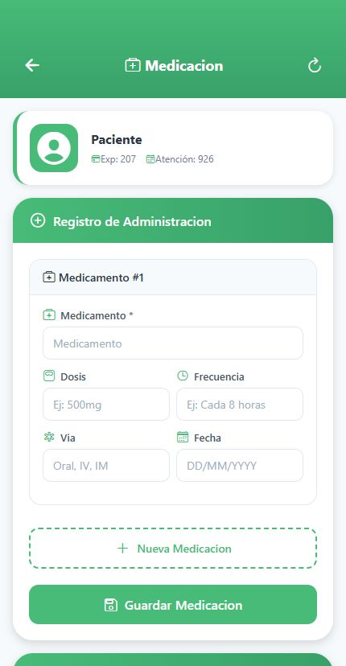

## 22 Valoración de enfermería

Ruta  Enfermeria → Paciente → Valoracion

Datos y controles. Apariencia general, dolor, movilidad, nivel de consciencia, condición de la piel y observaciones, tal como se muestran en la pantalla.

1. Consultar las valoraciones anteriores cuando existan.

2. Capturar el estado general y los demás campos mostrados.

3. Completar nivel de consciencia, condición de la piel y observaciones según los campos visibles.

4. Revisar y guardar una vez.

5. Comprobar la nueva entrada en el historial.

Resultado esperado. La valoración conserva su fecha y contexto de atención.

La pantalla revisada no presenta una escala de riesgo de caídas independiente. No confundir esta valoración con la alerta de posible caída del MPU.

Figura U22. Valoración de enfermería. Cliente Expo web conectado a QA; datos sintéticos.

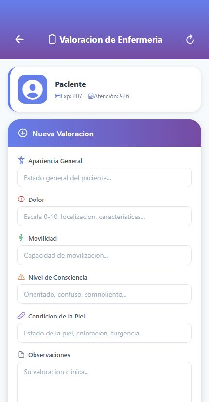

## 23 Balance hídrico

Ruta  Enfermeria → Paciente → Balance Hidrico

Datos y controles. Entrada oral e intravenosa y salida por orina y drenaje, en ml, además de observaciones.

1. Capturar los volúmenes en las unidades indicadas.

2. Revisar el periodo y los conceptos antes de guardar.

3. Comprobar que los valores numéricos sean válidos.

4. Guardar y abrir el historial.

5. Verificar los totales y el registro del periodo.

Resultado esperado. El balance queda relacionado con la atención.

No introducir números de ejemplo en una atención real. La interpretación clínica corresponde al personal autorizado.

Figura U23. Balance hídrico. Cliente Expo web conectado a QA; datos sintéticos.

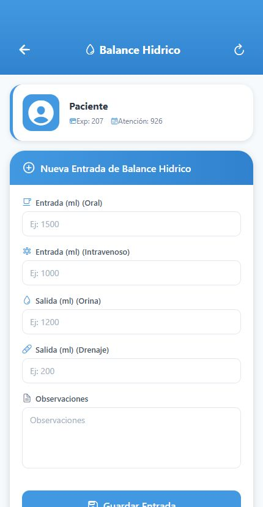

## 24 Plan y evaluación de cuidados

Ruta  Enfermeria → Paciente → Cuidados

Datos y controles. Diagnóstico de enfermería, objetivos, intervenciones, evaluación, estado y observaciones.

1. Comprobar el paciente y consultar el historial cargado.

2. Redactar el diagnóstico de enfermería y los objetivos.

3. Capturar intervenciones, evaluación y el estado correspondiente.

4. Revisar los campos y pulsar Guardar.

5. Esperar la verificación y consultar el historial actualizado.

Resultado esperado. El registro de cuidados queda vinculado con la atención.

Si el historial está en error o se pierde la sesión, resolver el mensaje y confirmar el contexto antes de guardar.

Figura U24. Plan y evaluación de cuidados. Cliente Expo web conectado a QA; datos sintéticos.

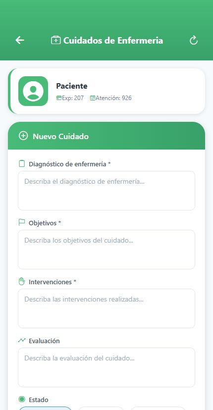

## 25 Gestión de estudios

Ruta  Dashboard → Estudios

Datos y controles. Categorías de solicitudes y resultados de laboratorio y gabinete, contadores, tarjetas y paginación.

1. Elegir Solicitudes de laboratorio, Solicitudes de gabinete o la categoría de resultados.

2. Localizar el expediente y el estudio avanzando con las flechas de paginación.

3. Verificar nombre, atención, estudio y estado antes de elegir una acción.

4. Abrir Ver, Subir o Editar según los controles disponibles.

5. Actualizar la lista y comprobar el estado final.

Resultado esperado. El operador trabaja sobre la solicitud correcta.

La captura muestra sólo la cabecera y las categorías para no publicar datos de otros pacientes. La lista revisada no tiene un campo de búsqueda; usar las páginas y la categoría correcta.

Figura de estudios. Cabecera y categorías de la lista. El área con datos de otros pacientes queda fuera de la captura.

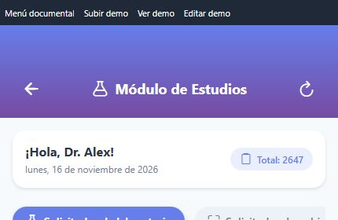

## 26 Subir editar y consultar un resultado

Ruta  Estudios → Solicitud → Subir resultado o Editar

Datos y controles. Archivo PDF, PNG o JPEG admitido, observaciones y datos de la solicitud.

1. Verificar expediente, atención y estudio en la cabecera.

2. Elegir el archivo con el selector del dispositivo.

3. Revisar el archivo y escribir las observaciones pertinentes.

4. Confirmar la carga o actualización y esperar el resultado.

5. Volver a la lista y abrir Ver para comprobar la versión disponible.

Resultado esperado. La solicitud muestra un resultado que puede consultarse con autorización.

No borrar un resultado como paso rutinario de edición. Respetar el límite de tamaño del servidor y evitar incluir documentos reales en evidencias académicas.

Figura U26. Subir editar y consultar un resultado. Cliente Expo web conectado a QA; datos sintéticos.

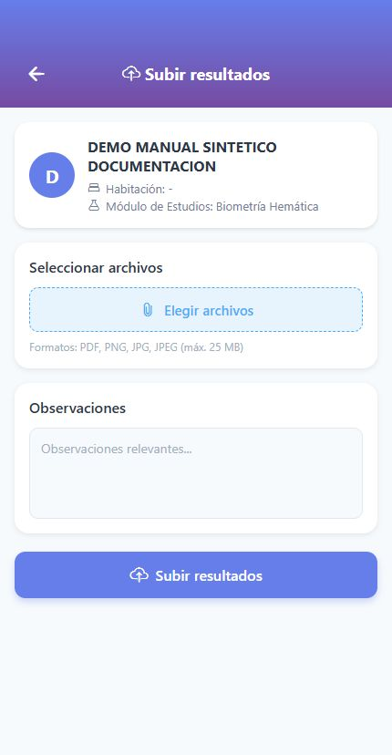

## 27 Configuración del sistema

Ruta  Dashboard → Configuracion

Datos y controles. Usuarios, diagnósticos, camas, servicios, respaldo, automatización y perfil.

1. Entrar con una cuenta autorizada para configuración.

2. Elegir el catálogo o proceso que se desea administrar.

3. Usar la flecha superior para volver a Configuracion.

4. Comprobar el resultado después de una modificación.

5. Cerrar la sesión al terminar en un dispositivo compartido.

Resultado esperado. La configuración se organiza por proceso.

Los cambios administrativos pueden afectar a todo el ambiente. Las capturas muestran consultas; no acreditan ejecución de restauraciones ni cambios de permisos.

Figura U27. Configuración del sistema. Cliente Expo web conectado a QA; datos sintéticos.

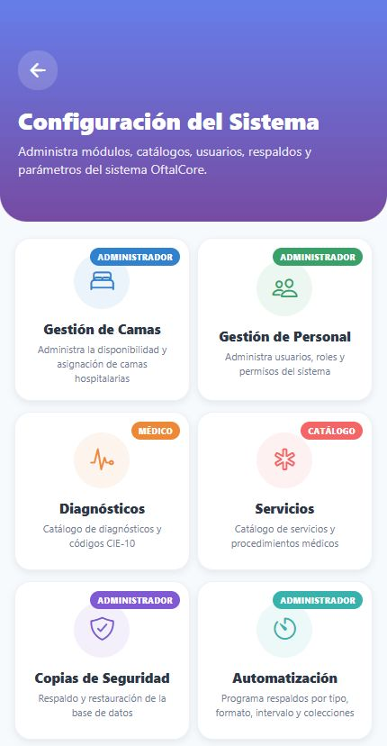

## 28 Usuarios y roles

Ruta  Configuracion → Usuarios

Datos y controles. Datos personales y del sistema: CURP, nombre, apellidos, nacimiento, teléfono, matrícula o cédula, cargo, correo, pregunta de seguridad, usuario, contraseña y rol según el formulario.

1. Consultar y filtrar la lista de usuarios.

2. Para alta, abrir el formulario y completar los datos requeridos.

3. Asignar el rol mínimo necesario y revisar antes de guardar.

4. Para una corrección, abrir Editar en la cuenta correcta.

5. Comprobar el resultado con la cuenta y el rol autorizados.

Resultado esperado. La cuenta queda disponible según su estado y permisos.

No publicar contraseñas ni claves en el manual. La eliminación o el cambio de rol de una cuenta debe realizarlo el responsable autorizado; no se ejecuta como prueba de capturas.

Figura U28. Usuarios y roles. Cliente Expo web conectado a QA; datos sintéticos.

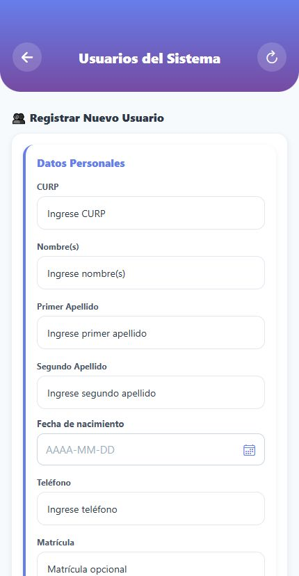

## 29 Servicios y diagnósticos del catálogo

Ruta  Configuracion → Servicios o Diagnosticos

Datos y controles. Servicios: clave, descripción, precio principal, código SAT, clave de unidad e IVA. Diagnósticos: clave y descripción del catálogo.

1. Consultar el catálogo y utilizar su búsqueda.

2. Abrir Nuevo para registrar un concepto cuando corresponda.

3. Completar y revisar los campos del formulario.

4. Para corregir un concepto, utilizar Editar.

5. Guardar y comprobar que el registro aparece en la lista.

Resultado esperado. Los formularios consumen los conceptos del catálogo actualizado.

Un precio de servicio puede afectar cargos futuros. No confundir un diagnóstico del catálogo con el diagnóstico clínico de una atención.

Figura U29. Servicios y diagnósticos del catálogo. Cliente Expo web conectado a QA; datos sintéticos.

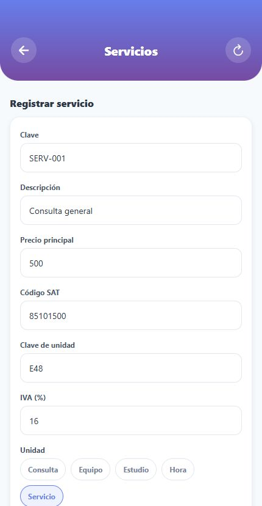

## 30 Respaldos manuales

Ruta  Configuracion → Respaldo

Datos y controles. Tipo completa, incremental o diferencial; formato JSON, CSV, Excel o PDF; colecciones y lista de archivos.

1. Consultar el estado del sistema y seleccionar las colecciones necesarias.

2. Elegir tipo y formato de respaldo.

3. Revisar la selección y ejecutar la creación autorizada.

4. Esperar la operación; localizar el archivo en la lista.

5. Descargar el respaldo y verificar su integridad y acceso restringido.

Resultado esperado. Se obtiene un archivo según las capacidades del servicio.

Restaurar modifica datos del ambiente y requiere el procedimiento del manual técnico. Un PDF o Excel de consulta no debe asumirse como respaldo restaurable completo. No se restauró producción para estas capturas.

Figura U30. Respaldos manuales. Cliente Expo web conectado a QA; datos sintéticos.

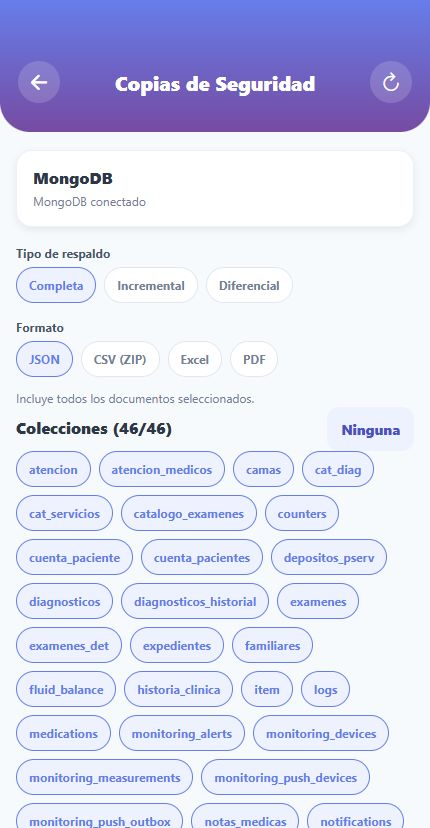

## 31 Automatización de respaldos

Ruta  Configuracion → Automatizacion

Datos y controles. Activación, tipo, formato, intervalo, retención máxima y colecciones.

1. Consultar la configuración actual antes de cambiarla.

2. Elegir tipo, formato y colecciones.

3. Definir intervalo y máximo de archivos de acuerdo con la política de operación.

4. Activar o desactivar únicamente cuando esté autorizado.

5. Guardar y comprobar que el servicio efectivamente ejecuta la programación.

Resultado esperado. La configuración queda persistida por la API.

Guardar una programación no demuestra que el planificador esté ejecutándose. Revisar los archivos generados y los logs del servidor.

Figura U31. Automatización de respaldos. Cliente Expo web conectado a QA; datos sintéticos.

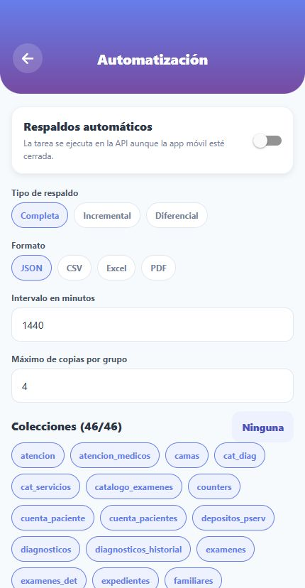

## 32 Perfil de la cuenta

Ruta  Configuracion → Perfil

Datos y controles. Datos de la cuenta autenticada presentados en modo de consulta.

1. Confirmar que el perfil corresponde al usuario autenticado.

2. Consultar los datos personales y del sistema disponibles.

3. Si se requiere una corrección, solicitarla al administrador desde la gestión de usuarios.

4. Regresar a Configuracion o cerrar la sesión.

Resultado esperado. Se consultan los datos de la cuenta; esta pantalla no se presenta como un formulario de edición.

Una modificación de perfil no concede nuevos permisos. Las credenciales se administran mediante el procedimiento autorizado de cuentas.

Figura U32. Perfil de la cuenta. Cliente Expo web conectado a QA; datos sintéticos.

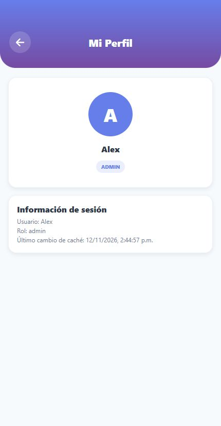

## 33 Monitoreo de pacientes

Ruta  Dashboard o menú → Monitoreo de pacientes

Datos y controles. Búsqueda, paginación, última lectura, dispositivo, pulso, SpO₂, movimiento, temperatura del sensor y alertas pendientes.

1. Usar el APK QA para el prototipo actualmente asociado a ese ambiente.

2. Buscar el expediente autorizado y revisar la última actualización.

3. Cambiar de página con Anterior y Siguiente cuando aparezcan.

4. Usar Actualizar para solicitar una consulta nueva.

5. Abrir Ver lecturas y alertas en el paciente correcto.

Resultado esperado. La lista presenta hasta diez registros por página.

La caché es temporal. La vista consulta cada diez segundos mientras está activa. Temperatura del sensor no significa temperatura corporal.

Figura U33. Monitoreo de pacientes. Cliente Expo web conectado a QA; datos sintéticos.

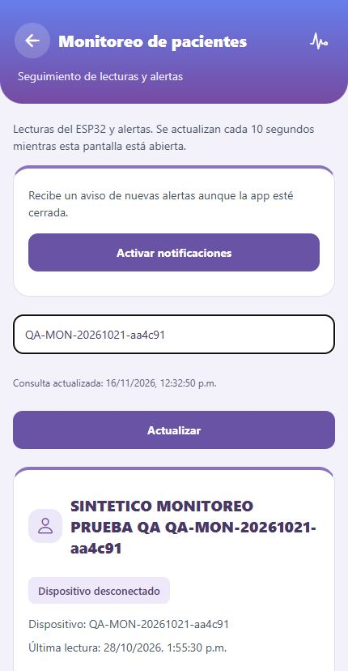

## 34 Lecturas alertas y asociación del ESP32

Ruta  Monitoreo → Ver lecturas y alertas

Datos y controles. Historial paginado, alertas, reconocimiento y formulario de asociación reservado al administrador.

1. Confirmar el expediente y el identificador del dispositivo.

2. Revisar hora de la última lectura y estado: reciente, desconectado o sin contacto.

3. Consultar las páginas de historial y de alertas.

4. Para una alerta revisada, pulsar Reconocer alerta y comprobar que deja de estar pendiente.

5. Asociar un dispositivo sólo al configurarlo: copiar su identificador exacto y proteger la credencial generada.

Resultado esperado. Web y móvil consultan el mismo backend del ambiente.

Renovar la asociación genera una credencial nueva que debe actualizarse en el ESP32. No hacerlo para consultar lecturas. Una alerta de prueba debe identificarse como simulada. La captura del 16 de noviembre muestra el dispositivo desconectado y lecturas históricas del 28 de octubre; no acredita una transmisión nueva.

Figura U34. Lecturas alertas y asociación del ESP32. Cliente Expo web conectado a QA; datos sintéticos.

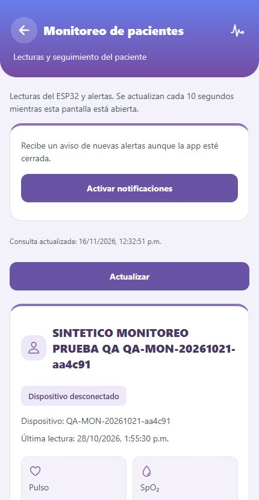

## 35 Notificaciones con la app en segundo plano

Ruta  Monitoreo → Activar notificaciones

Datos y controles. Permiso Android y registro del dispositivo móvil para la sesión actual.

1. Instalar el APK QA y entrar con una cuenta clínica autorizada.

2. Pulsar Activar notificaciones y conceder el permiso de Android.

3. Mantener Internet y generar una alerta de prueba en QA.

4. Cerrar normalmente la app y comprobar la recepción.

5. Tocar el aviso y verificar que abre el paciente permitido; iniciar sesión si se solicita.

Resultado esperado. La recepción depende del permiso, el token y el envío del backend.

Forzar detencion en Android puede impedir avisos hasta volver a abrir la app. La captura web ilustra el botón; no acredita transporte push nativo.

Figura U35. Notificaciones con la app en segundo plano. Cliente Expo web conectado a QA; datos sintéticos.

## 36 Instalación y preparación de la demostración

Descargar el APK QA del proyecto y verificar su procedencia. En Android, abrir el archivo y conceder sólo el permiso necesario al instalador o gestor de archivos utilizado. Iniciar OftalCore QA, comprobar el nombre y entrar con una cuenta habilitada. Mantener Internet y esperar el primer arranque del servicio.

El dispositivo de referencia requiere Android compatible con el APK. Las herramientas del SDK verificaron minSdk 24 en los binarios build 8 de la entrega anterior. Registrar modelo, versión de Android, build y fecha en la aceptación; esa comprobación estática no sustituye instalar y ejecutar el APK.

Para la demostración de IoT, encender el ESP32 con alimentación y red adecuadas. Usar el expediente OFTALCORE-000205 de QA y comprobar la última recepción. El expediente 207 se creó para capturar los formularios del manual y no tiene por sí mismo un dispositivo de monitoreo asociado.

No renovar la credencial del ESP32 para una consulta. Usar prueba-caida sólo para una alerta simulada; no dejar caer el prototipo. La prueba física del MPU y el transporte push del nuevo APK se registran por separado.

## Secuencia sugerida de presentación

1. Mostrar el repositorio y los manuales de la misma entrega.

2. Instalar QA e iniciar sesión; abrir un módulo autorizado.

3. Mostrar el expediente sintético y explicar la relación expediente y atención.

4. Abrir monitoreo en el expediente IoT, revisar lecturas y reconocer una alerta sintética.

5. Cerrar la sesión y comprobar que se solicita autenticación para volver a consultar.

## 37 Errores frecuentes y recuperación

| Situación | Qué hacer |
| --- | --- |
| Error de conexión | Comprobar Internet, ambiente, URL y disponibilidad del servicio; esperar el arranque frío y reintentar. |
| Credenciales rechazadas | Revisar usuario y contraseña. No repetir intentos de manera continua; solicitar apoyo si persiste. |
| Sesión expirada o 401 | Iniciar sesión de nuevo y volver a seleccionar la atención. |
| Acceso denegado o 403 | Solicitar revisión del rol; no modificar identificadores para eludir el permiso. |
| Paciente no aparece | Revisar búsqueda, grupo, página y ambiente. Usar Recargar. |
| Fallo al consultar censo | Recargar y registrar el mensaje y la hora; operación revisa endpoint y logs. |
| Guardado incierto | Consultar el historial antes de reenviar. Conservar el borrador cuando la pantalla lo permita. |
| Archivo no disponible | Comprobar estado del estudio, sesión, tamaño y formato admitido. |
| Sin lecturas IoT | Revisar última lectura, alimentación, WiFi, ambiente y credencial. |
| Sin notificación | Revisar permiso Android, sesión, Internet y habilitación del envío del backend. |

Para soporte indicar ambiente, nombre de pantalla, pasos, hora, modelo y versión de app. No enviar contraseñas, JWT, URLs con token ni documentos de pacientes reales. La captura de censo de esta sesión muestra un fallo de consulta y se conserva como ejemplo; no se declara que ese caso haya sido aprobado.

## 38 Cierre de sesión y registro de aceptación

1. Usar Cerrar sesion en el menú o el control del inicio.

2. Confirmar la salida si Android lo solicita.

3. Comprobar que la aplicación regresa al acceso.

4. En un equipo compartido, verificar también que no queden archivos descargados en una ubicación pública.

El servidor recibe una solicitud de revocación y el cliente limpia la sesión y sus cachés. Si falla la red, la limpieza local se realiza igualmente; la revocación remota debe verificarse al recuperar conectividad. No confundir cerrar una pantalla con cerrar la sesión.

| Prueba del APK nuevo | Resultado por registrar |
| --- | --- |
| Instalación y acceso | Modelo, Android, build, login válido e inválido. |
| Uso por rol | Navegación, selección de atención y rechazo de acceso no autorizado. |
| Registro sintético | Guardado y consulta posterior en cada módulo probado. |
| Archivos | Carga, descarga y apertura del documento de demostración. |
| IoT y avisos | Lectura, alerta simulada, reconocimiento y notificación con app cerrada. |
| Cierre | Regreso a login y rechazo del recurso tras la revocación. |

Las pruebas automatizadas y compilaciones anteriores conservan sus evidencias. Esta ampliación documenta procedimientos y vistas; el registro de aceptación del nuevo APK en teléfono debe contener resultados reales y responsable. Las funciones que no se hayan ejecutado deben quedar pendientes, sin marcarse aprobadas.

## 39 Referencias visuales de estudios y catálogos

Estas vistas complementan los procedimientos de solicitud, consulta de resultados y mantenimiento de catálogos. Las solicitudes del expediente documental usan datos sintéticos; las opciones disponibles dependen de los permisos del usuario.

Figuras complementarias. Solicitud de gabinete y consulta de resultados del paciente de documentación. Cliente Expo web en QA.

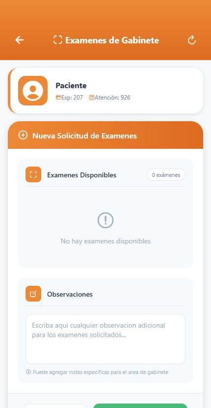

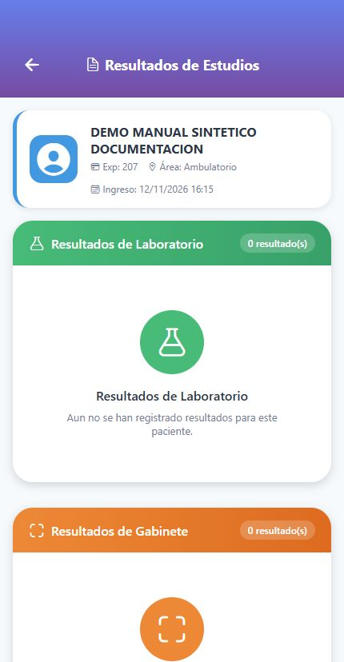

## 40 Referencias de configuración y navegación

El menú lateral organiza las funciones del módulo actual. Las opciones clínicas requieren seleccionar previamente el expediente y la atención. En el móvil se utiliza la navegación y el gesto de menú que ofrezca la plataforma; el control documental agregado a la exportación web no forma parte del APK.

Figuras complementarias. Catálogo de diagnósticos y configuración de camas. Los datos de los formularios se completan antes de confirmar una operación autorizada.

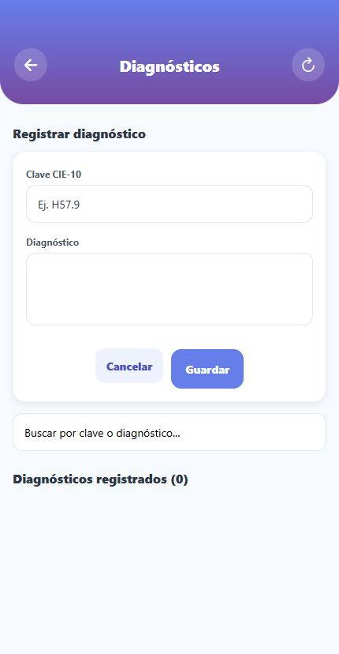

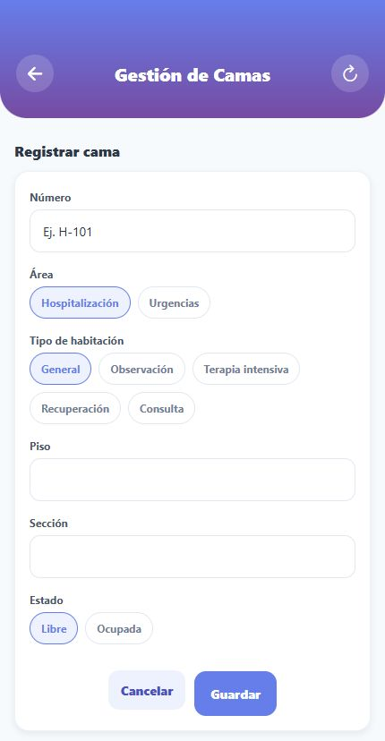

## 41 Consulta y edición de resultados de demostración

La solicitud 5237 pertenece a la atención sintética 926. El archivo preparado para mostrar estas vistas indica que no tiene validez clínica. Se cargó por la API de QA como dato de documentación; las capturas no acreditan que se haya realizado la carga desde el selector nativo del APK.

Figuras complementarias. Edición de observaciones y consulta del PDF sintético. No se eliminaron archivos ni se modificaron registros reales.

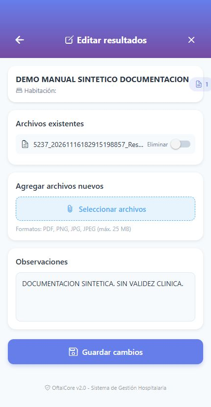

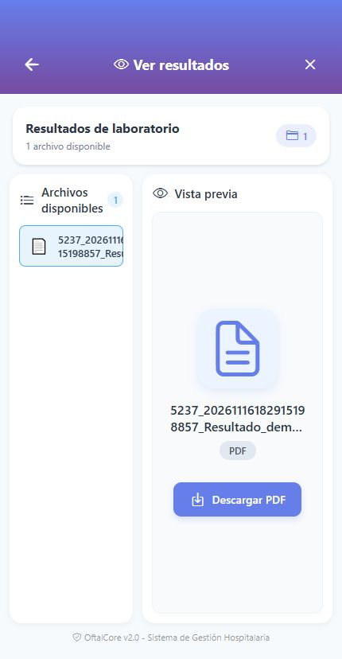
